<div align="center">


# Swapjutsu

**Free, open-source app to swap a character in a video on Mac. No watermark.**

Put any character into any clip. The camera, the moves and the timing stay; the person changes.
Everything up to the render runs on your Mac, for free.

[](https://github.com/jutsuhq/swapjutsu-seedance-character-swap/releases/latest)

[Examples](#examples) · [Install](#install) · [Quick start](#quick-start) · [How it works](#how-it-works) ·
[Rendering](#rendering) · [Agents](#agents) · [Docs](#documentation) · [Website](https://jutsustudio.com/swapjutsu/)

[](https://github.com/jutsuhq/swapjutsu-seedance-character-swap/releases/latest)
[](LICENSE)
[](#requirements)
[](https://swift.org)
[](#how-it-works)
[](#disclaimer)

</div>

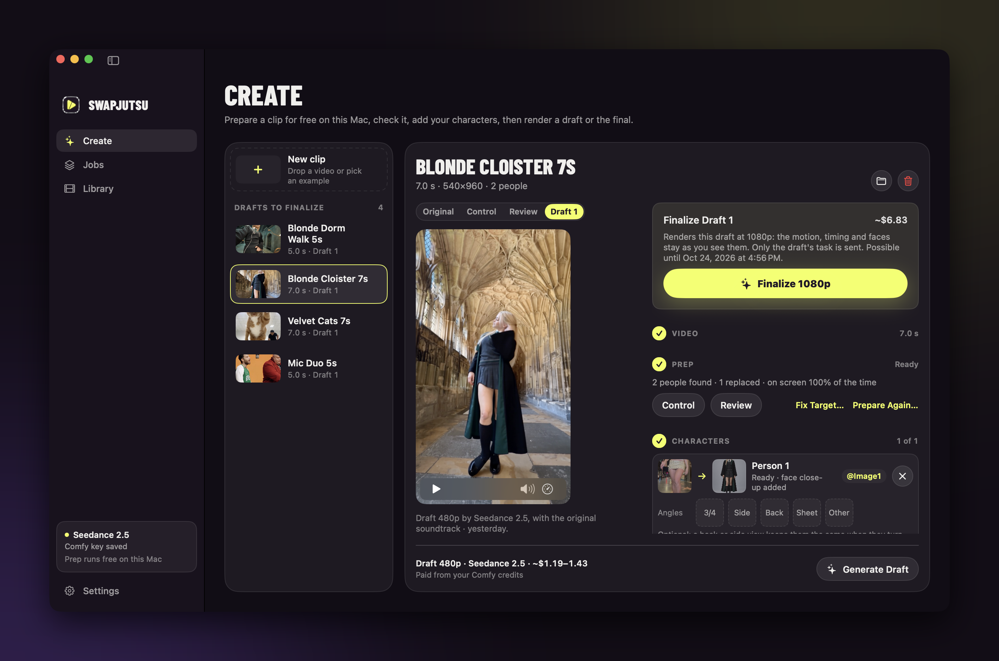

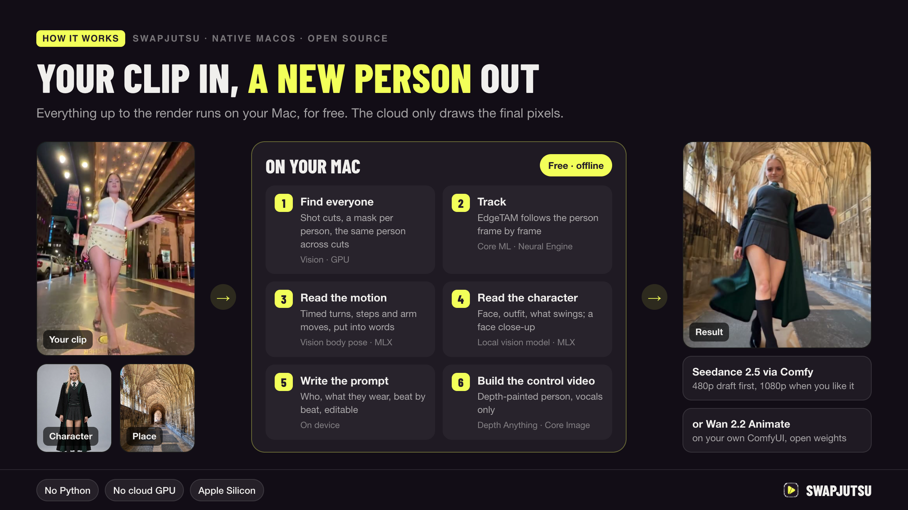

## Examples

Unedited Seedance 2.5 drafts at 480p, the cheapest render.

<div align="center">

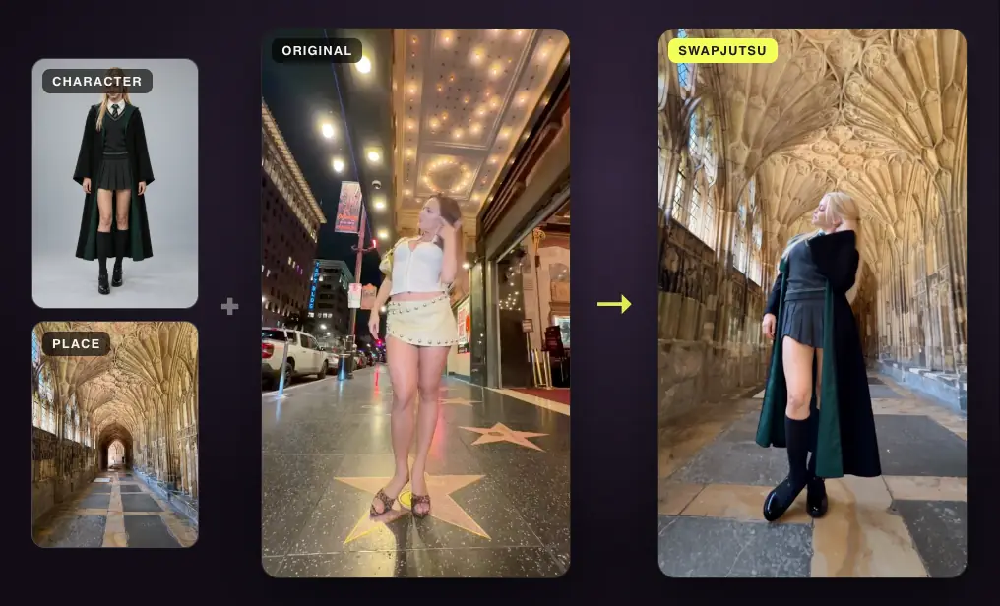

**Cloister** · one character, new place · 7 s · $1.19

<br>

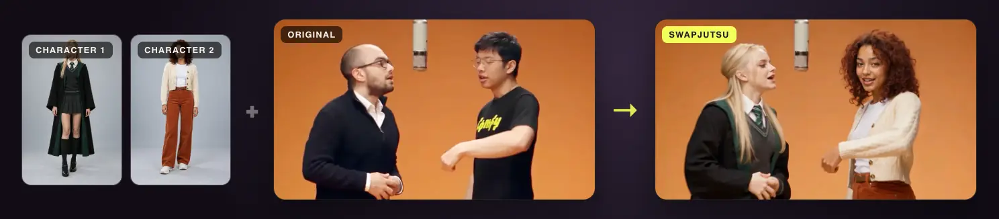

**Duo** · two characters, one each · 5 s · $0.85

</div>

## Install

Download `Swapjutsu-<version>.dmg` from the [latest release](https://github.com/jutsuhq/swapjutsu-seedance-character-swap/releases/latest) and drag the app to Applications.
It is signed and notarized, for Apple Silicon on macOS 15 or later. To check the download:

```bash
shasum -a 256 -c Swapjutsu-<version>.dmg.sha256
```

Models download on first use and are verified against pinned SHA-256 hashes.

## Quick start

1. **Add a Comfy key.** Create one at [platform.comfy.org](https://platform.comfy.org/profile/api-keys), add
   credits, and paste it in Settings › Comfy. It is stored in the Keychain.
2. **Prepare a clip.** In Create, drop a clip (or show the examples and pick one), trim it to 4–30 s, choose who to
   replace and click **Prepare Clip**. This runs on the Mac and costs nothing.
3. **Assign characters.** Drop an image for each person, and a place if you replace the background. The prompt
   writes itself (download Qwen3-VL 8B in Settings › Prompt for the best one); edit it if you want.
4. **Render a draft.** **Generate Draft** shows the price before it sends anything. Results land in Library.
5. **Finalize.** Happy with the draft? **Finalize 1080p** within 7 days, with the same motion.

## How it works

| | Step | On | What happens | Details |
|---|---|---|---|---|
| 1 | Shots | Mac | Cuts found from feature-print and colour-histogram jumps | [02](docs/stages/02-shot-cuts.md) |
| 2 | People | Mac | A separate mask per person: Vision instances + person matte | [03](docs/stages/03-people.md) |
| 3 | Tracking | Mac | EdgeTAM in Core ML on the Neural Engine; the same person kept across cuts | [05](docs/stages/05-tracking-identity.md) |
| 4 | Motion | Mac | A pose tracker times the moves, a local vision model (MLX) names them | [prompt writer](docs/ARCHITECTURE.md#the-prompt-writer-any-vision-model-behind-one-protocol) |
| 5 | Characters | Mac | The same model reads each character image; face close-ups for full-body shots | [04](docs/stages/04-faces.md) · [10](docs/stages/10-character-cutout.md) |
| 6 | Depth | Mac | Depth Anything V2 in Core ML, one scale per shot | [07](docs/stages/07-depth.md) |
| 7 | Control video | Mac | The person painted in depth over the original; vocals only, +3 semitones | [08](docs/stages/08-control-video.md) · [09](docs/stages/09-soundtrack.md) |
| 8 | Render | Comfy or your GPU | Seedance 2.5 or Wan 3.0, or Wan 2.2 Animate on your own ComfyUI | [11](docs/stages/11-generation.md) |

<details>
<summary>Every step as a diagram</summary>

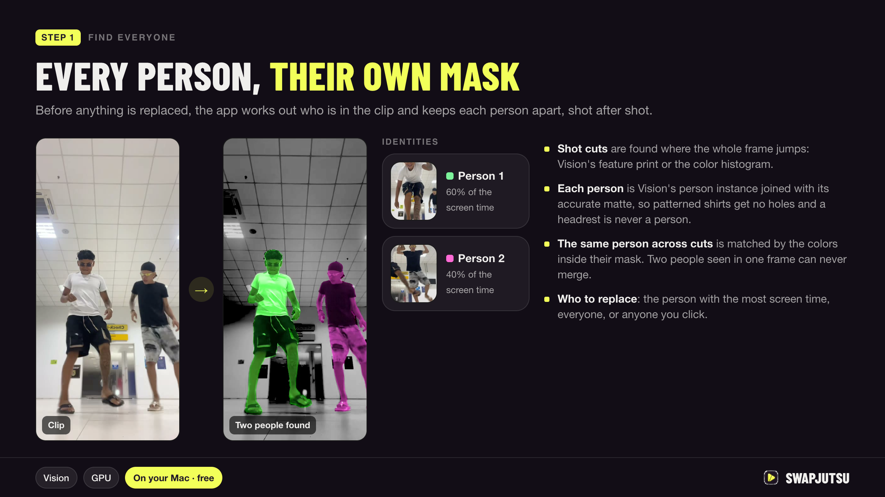
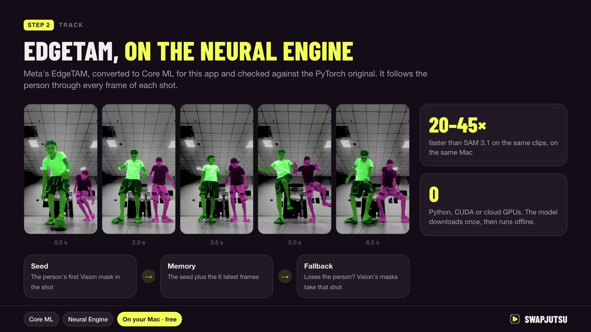
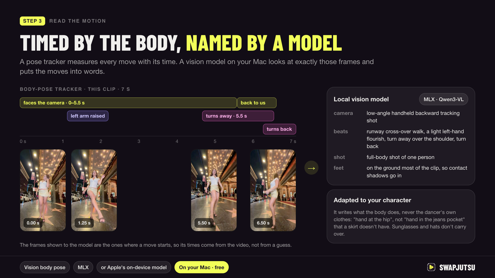
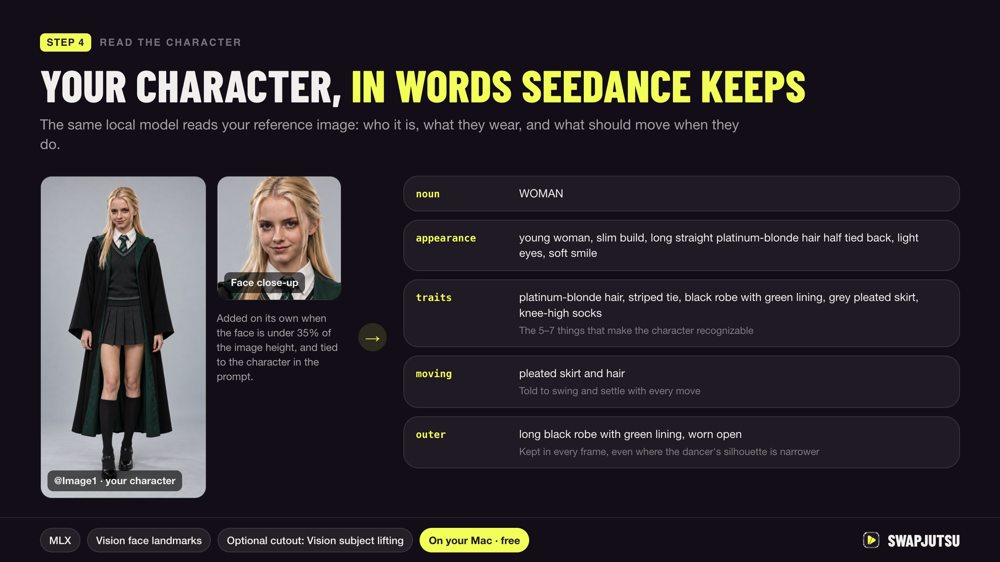
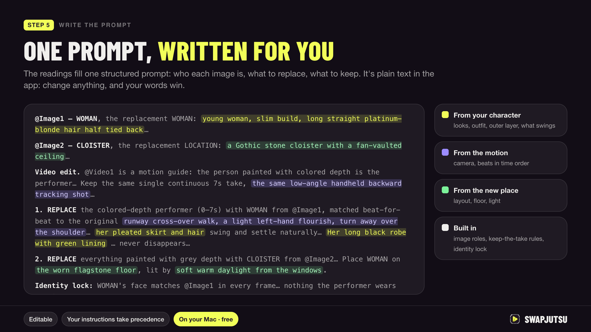
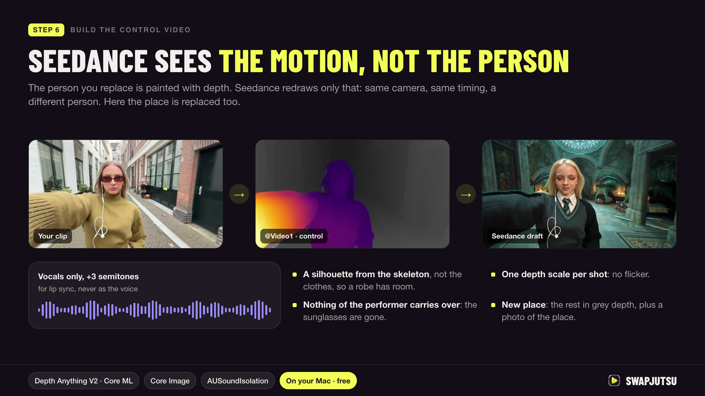
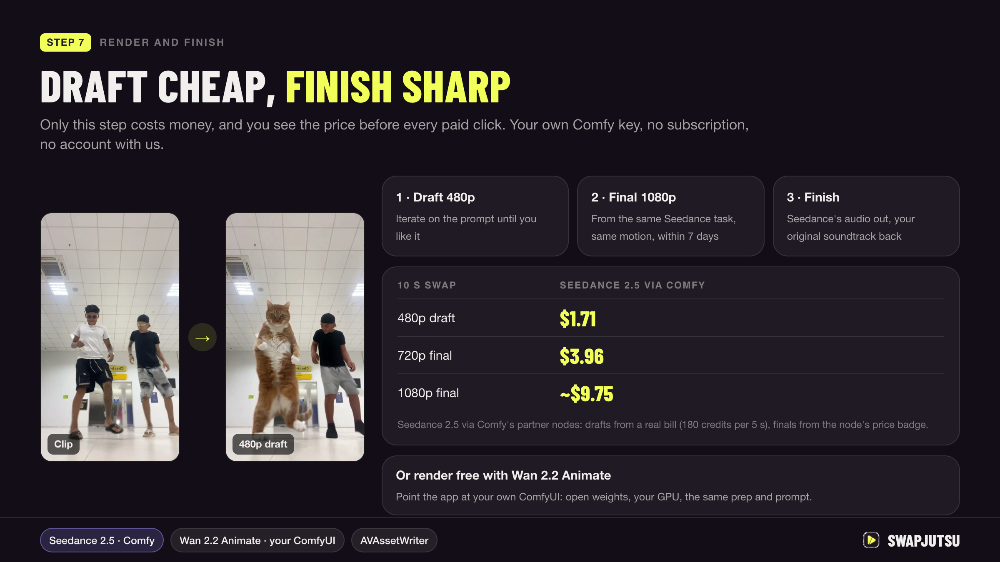
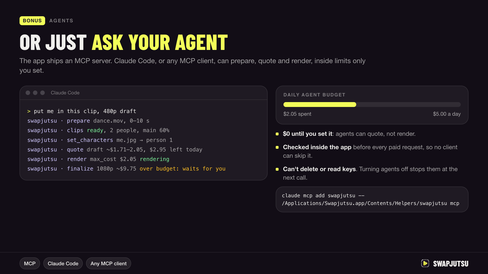

</details>

Why each step works the way it does: [docs/PIPELINE.md](docs/PIPELINE.md).

## Rendering

| Route | Model | Billing |
|---|---|---|
| Direct (default) | Seedance 2.5 through Comfy's Partner Nodes API | Prepaid Comfy credits, no subscription |
| Direct | Wan 3.0 through Comfy's Partner Nodes API, clips up to 15 s | Prepaid Comfy credits, for the control video's seconds plus the render's |
| Comfy Cloud | Seedance 2.5 through the Comfy API | Comfy Cloud subscription |
| Own ComfyUI | Wan 2.2 Animate, open weights | Free, on your GPU |

For your own ComfyUI, enter its address in Settings › Own ComfyUI and click Check; Create offers Wan once the check
passes. Workflows, calls and what the server needs: [docs/COMFY_API.md](docs/COMFY_API.md).

## Agents

The app ships an MCP server, so Claude Code or any MCP client can prepare and render for you:

```bash
claude mcp add swapjutsu -- /Applications/Swapjutsu.app/Contents/Helpers/swapjutsu mcp
```

Off until you turn on Settings › Agents › Allow agents. Agents spend only within a daily budget you set, cannot delete
anything and never see your key. Tools and limits: [docs/AGENTS.md](docs/AGENTS.md).

## Build from source

```bash
scripts/fetch-models.sh
swift build --product Swapjutsu && .build/debug/Swapjutsu   # the app
swift build -c release && .build/release/swapjutsu-prep my-clip.mov   # the prep alone, no render
swift test
```

The command-line tool: [docs/CLI.md](docs/CLI.md). App bundle, tests and releases: [CONTRIBUTING.md](CONTRIBUTING.md).

## Requirements

- macOS 15+ on Apple Silicon; Xcode 27 and Swift 6.4 to build
- Prep: about 3–5 s per second of video and 250–500 MB of memory on an idle M4, with tracking
  ([measured](benchmarks/README.md#721-depth-on-a-crop-around-small-people)); slower while other apps use the GPU
- Local prompt writer: 16 GB of memory (Qwen3-VL 8B, 5.8 GB download)
- Render: Comfy credits, a Comfy Cloud subscription, or a ComfyUI server with a capable GPU

## Privacy

- No account and no telemetry. Swapjutsu has no server of its own, and prep runs offline on your Mac.
- Models come from Hugging Face and GitHub, each pinned to one commit or release and checked against SHA-256 before
  use. The depth and tracking models (about 100 MB) download with the first prep; a prompt writer model only when
  you click Download in Settings › Prompt.
- The examples in Create come from Higgsfield's public gallery and load only after you click **Show Examples** or
  turn on Settings › Prep › Higgsfield examples.
- A Seedance render uploads `control.mp4` and your images to Comfy. Wan gets the clip, its mask and your images, on
  your own ComfyUI.
- The Comfy key stays in the login Keychain.
- The prompt writer runs locally; if you point it at an API instead, it sends that API the images and a few frames.

## Documentation

- [PIPELINE.md](docs/PIPELINE.md): every step in one table, the control modes and the key decisions
- [stages/](docs/stages/README.md): one page per stage: how it works, why, numbers, papers
- [ARCHITECTURE.md](docs/ARCHITECTURE.md): modules, swappable stages, the prompt writer, sandbox and packaging
- [COMFY_API.md](docs/COMFY_API.md): Seedance on Comfy and Wan 2.2 on your own ComfyUI
- [AGENTS.md](docs/AGENTS.md): MCP tools and spending controls
- [CLI.md](docs/CLI.md): `swapjutsu-prep` options and output
- [TESTING.md](docs/TESTING.md): tests and measured results
- [benchmarks/](benchmarks/README.md): the research behind the target masks, tracking and depth, with data and ground truth

Guides on jutsustudio.com:

- [How to swap a character in a video with AI](https://jutsustudio.com/blog/how-to-swap-character-in-video/)
- [Face swap vs character swap](https://jutsustudio.com/blog/face-swap-vs-character-swap/)
- [Higgsfield Genjutsu alternatives, free and paid](https://jutsustudio.com/blog/genjutsu-alternatives/)
- [Seedance 2.5 guide: modes, limits and cost](https://jutsustudio.com/blog/seedance-2-5-guide/)

## Disclaimer

Unofficial and community-built. Not affiliated with, endorsed by, or connected to Higgsfield AI, ByteDance or
Comfy Org. Genjutsu, Seedance, ComfyUI and other names are trademarks of their respective owners. Renders are
billed to your own Comfy account.

## Credits

- [EdgeTAM](https://github.com/facebookresearch/EdgeTAM) by Meta, Apache-2.0, in our
  [Core ML conversion](https://github.com/jutsuhq/edgetam-coreml). Not affiliated with or endorsed by Meta.
- [Depth Anything V2 Small](https://huggingface.co/apple/coreml-depth-anything-v2-small), Apple's Core ML
  conversion, Apache-2.0.
- Prompt writer models, downloaded from Hugging Face only when chosen, as 4-bit MLX conversions by
  [mlx-community](https://huggingface.co/mlx-community):
  [Qwen3-VL 8B](https://huggingface.co/Qwen/Qwen3-VL-8B-Instruct) (the default),
  [Qwen3.5 9B](https://huggingface.co/Qwen/Qwen3.5-9B), [Qwen3.5 35B-A3B](https://huggingface.co/Qwen/Qwen3.5-35B-A3B)
  and [Qwen3.8 27B](https://huggingface.co/Qwen/Qwen3.8-27B) by the Qwen team, Alibaba Cloud, and
  [Gemma 4 E4B](https://huggingface.co/google/gemma-4-E4B-it) by Google; all Apache-2.0. The Gemma conversion is
  labeled with the [Gemma Terms of Use](https://ai.google.dev/gemma/terms), which apply alongside.
- [Wan 2.2 Animate](https://github.com/Wan-Video/Wan2.2) by Alibaba's Wan team, Apache-2.0. Runs on your own
  ComfyUI; not bundled or downloaded.
- [ComfyUI](https://github.com/comfyanonymous/ComfyUI) by Comfy Org, GPL-3.0. Used through its API only.
- [Barlow Condensed](https://github.com/jpt/barlow), [SIL OFL 1.1](Sources/SwapjutsuApp/Resources/Fonts/OFL.txt).

The models are not in the repository: the app downloads them on first use, and `scripts/fetch-models.sh` fetches
the same files for the command-line tool. The licenses of the Swift packages compiled into the app (MLX, Hugging
Face's swift-transformers and others) ship with it in
[ThirdPartyNotices.txt](Sources/SwapjutsuApp/Resources/ThirdPartyNotices.txt), under Swapjutsu › Acknowledgements;
`scripts/third-party-notices.sh` regenerates it when `Package.resolved` changes.

## License

[MIT](LICENSE) © Swapjutsu contributors.
