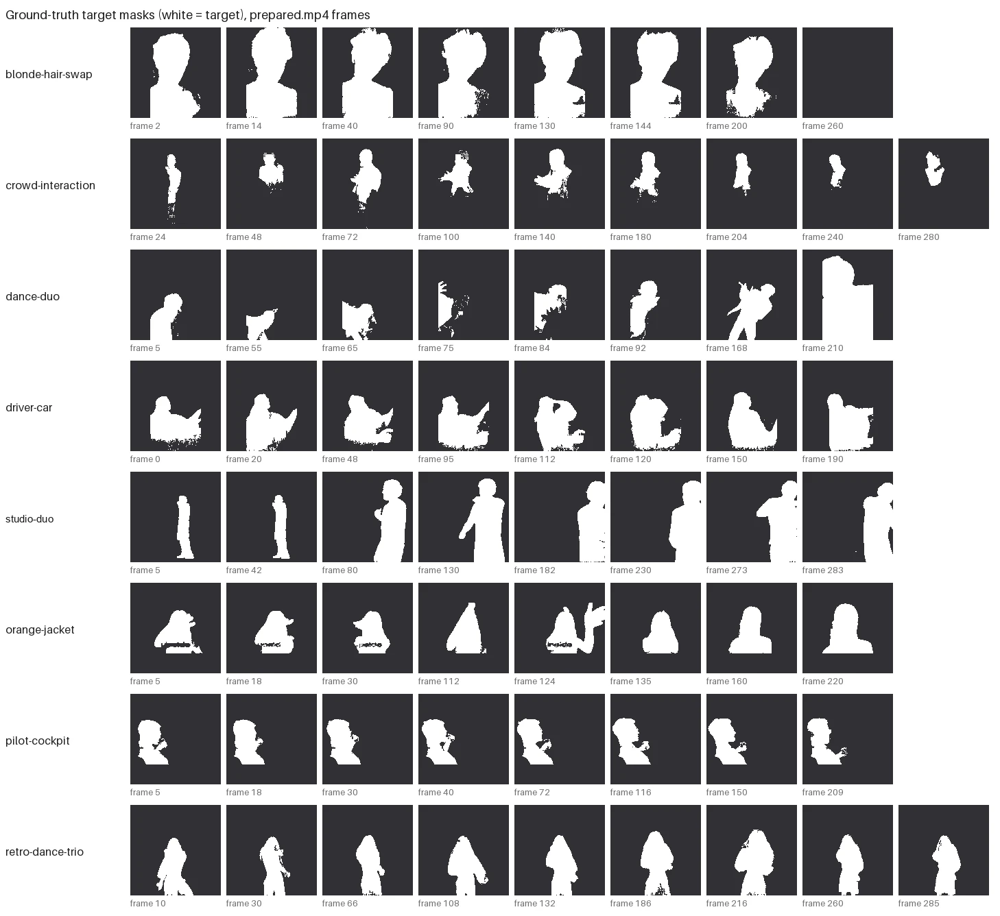
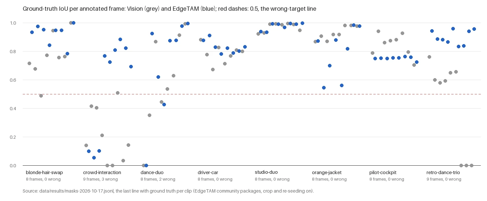
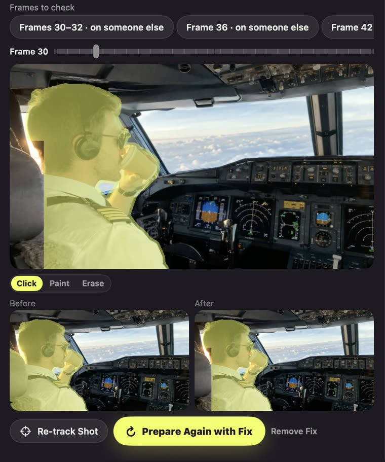
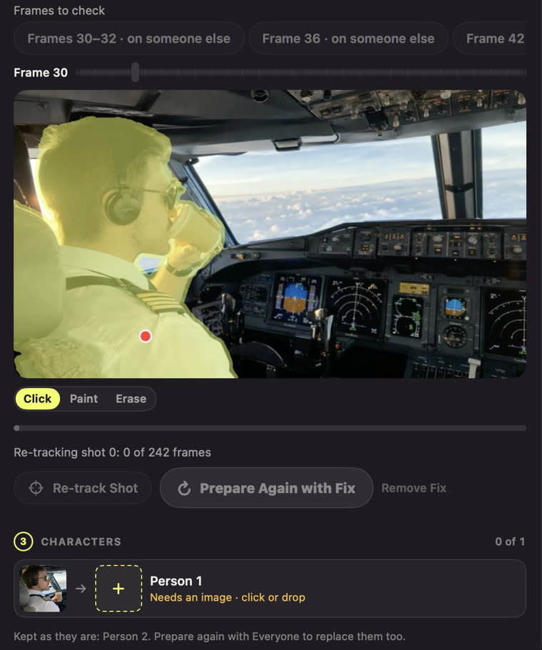
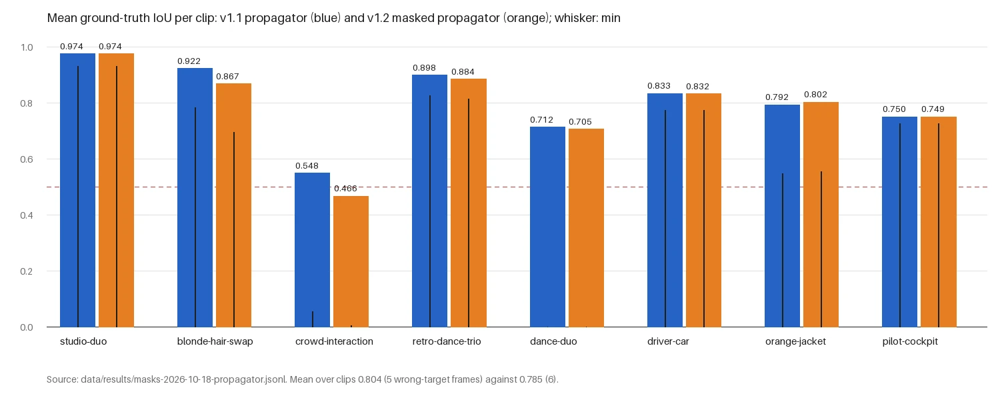
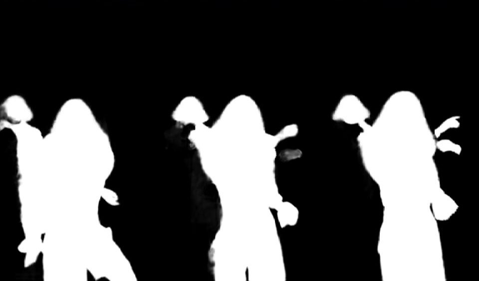

# Target-Person Masks for Depth-Controlled Character Swap on Apple Silicon

*A benchmark of Apple Vision, EdgeTAM and SAM 3.1, and of the tracking, depth and control-video choices in
Swapjutsu's on-device preparation pipeline. Measurements of 16–18 October 2026.*

## Abstract

Swapjutsu replaces a person in a video clip with a character from a reference image. A video model, Seedance 2.5,
does the generation; everything it is given is prepared locally on a Mac: a control video in which the person to be
replaced is painted with colour-mapped depth over the original frames. Every error in the target person's mask
reaches the model directly. A mask that leaks onto a neighbour paints the neighbour, and a mask that loses a hand
leaves the original hand in the frame. We built a small benchmark for this problem: 17 clips (five test fixtures,
eleven examples from a public gallery and one further clip) and 66 hand-checked ground-truth masks on the eight
hardest of them. On it we compare Apple Vision's per-frame person masks with two promptable video segmenters,
EdgeTAM (Core ML) and SAM 3.1 (MLX), and evaluate about twenty further changes to the tracker, the depth stage and the
control video. EdgeTAM on the Neural Engine agrees with Vision as closely as SAM 3.1 does (within 0.015 IoU on the
five fixtures) at 60–74 ms per tracked frame against 7.5–10 s. On the ground-truth clips the shipped tracker reaches
a mean ground-truth IoU of 0.804 with 5 wrong-target frames out of 66, against 0.688 and 15 for Vision alone. Most
published improvements to SAM 2-style memory did not transfer: SAMURAI's motion-aware selection, DAM4SAM's
distractor memory, quality-gated memory, automatic seed choice, a mask-derived object pointer and a propagator that
masks empty memory slots each lost more on one clip than they gained on another. A video matting model did not
recover hair detail either. What did help was re-seeding from Vision only where Vision is confident, and a one-frame
correction by hand, which brings a failed shot from 0.550 to 0.743–0.765. The data, the ground truth and the
recorded results are published with this report.

## 1 Introduction

### 1.1 The task

A character swap takes a source clip, a character image and optionally an image of a new place, and returns the
clip with one or more people replaced. Seedance 2.5 takes reference images and a video to edit (`@Video1`). In
Swapjutsu the video it edits is not the original clip but a *control video*: inside an *edit region* around each
target person the frame is replaced by the person's relative depth, drawn with a colour map; outside it the original
pixels stay. The model then draws the character where the depth is, keeping the target's pose, shape and motion,
and keeps the rest of the frame.

The control video is built from one binary mask per target per frame. The mask's errors propagate in specific
ways:

- **Wrong target.** If the mask follows a neighbour, the neighbour is painted and replaced.
- **Missing parts.** A hand, hair or a held object outside the mask stays original. The model has to merge a
  character with leftover source pixels, and it draws stumps or doubled limbs.
- **Leaks.** A seat headrest or a car interior inside the mask is painted as part of the body.
- **Flicker.** A mask that changes shape from frame to frame changes the painted silhouette, which the model
  follows.

The pipeline runs on a laptop. The target machine for every measurement here is an Apple M4 with 16 GB of memory,
and the tracking budget was set at about 40 s added to a 12 s clip.

### 1.2 Questions

1. Which source of person masks to use: Vision's per-frame instance masks, or a promptable video segmenter seeded
   from them (Section 7.1)?
2. How fast can the chosen tracker run on the Neural Engine, and where should each model run (7.2, 7.13–7.15)?
3. Which published tracker and matting improvements help on our clips (7.5–7.9, 7.12, 7.16, 7.17)?
4. How much does a human correction of one frame help (7.11)?
5. Which depth and control-video choices hold up when measured (7.18–7.23)?

### 1.3 Contributions

- A benchmark of 17 clips with 66 ground-truth masks on the 8 clips where Vision or the tracker fails
  (Sections 4–5), with metrics that separate *right target* from *agreement* (Section 6).
- Measurements of EdgeTAM on Apple silicon per model and per compute unit, inside a full preparation pipeline.
- Negative results for SAMURAI's selection, DAM4SAM's memory, quality-gated memory, seed choice, a mask-derived
  object pointer, a masked-attention propagator, MatAnyone 2 matting, and upright depth input on portrait frames.

## 2 Related work

**Promptable video segmentation.** SAM 2 [1] extends Segment Anything to video with a streaming memory: each frame is
encoded once, a memory attention layer conditions it on a bank of past frames' memories and object pointers, and a
mask decoder returns three candidate masks with predicted IoUs and an object score. The bank holds the prompted
(conditioning) frames and a first-in, first-out queue of recent frames. SAM 3 [2] adds concept prompts (short noun
phrases and image exemplars) and a detector to the tracker. SAM 3.1 is a later release of the same family, which we
used through its MLX port (`mlx-community/sam3.1-bf16`, 3.5 GB) [3].

**On-device tracking.** EdgeTAM [4] replaces SAM 2's image encoder with a small backbone and compresses the memory
with a 2D spatial perceiver, so that tracking runs on a phone. Its video predictor has the same structure as SAM 2's:
image encoder, prompt encoder and decoder (here *initializer*), memory encoder, and memory attention with the
decoder (here *propagator*). A community Core ML conversion [5] made it usable from Swift. We later made our own
conversion from the official repository [6].

**Tracker memory.** SAMURAI [7] adds a Kalman filter on the target's box to SAM 2. It picks among the three candidate
masks by a weighted sum of the predicted IoU and the IoU with the Kalman prediction, and it admits a frame to memory
only when the mask, object and motion scores pass thresholds. DAM4SAM [8] splits the memory into a recent appearance
memory sampled at a stride and a distractor-resolving memory. A frame enters the latter when an alternative
candidate mask reaches towards a nearby distractor, and it is kept as a conditioning frame.

**Depth.** Depth Anything V2 [9] predicts relative inverse depth from one image. We use the Small model in Apple's
Core ML conversion [10]. Being a per-image model, it is not temporally consistent, which Section 7.22 addresses.

**Matting.** MatAnyone [11] is a video matting model seeded with a first-frame mask, with memory propagation built
for stable alpha over time. We tested its successor, MatAnyone 2, through a Core ML port [12].

**Character animation and replacement.** Wan-Animate [13], released with Wan 2.2 as Wan 2.2 Animate, animates or
replaces a character from a reference image, driven by pose and face features extracted from the source video, with a
relighting module for replacement. Swapjutsu also offers Wan 2.2 Animate on the user's own ComfyUI server as an
alternative to Seedance, and its silhouette drawn from the performer's skeleton follows the same idea of pose-led
replacement. Seedance [14] is a family of video generation models. We use version 2.5 through
provider APIs, as a black box.

**Apple Vision.** The pipeline's detector is Apple's Vision framework [15]: person instance masks
(`VNGeneratePersonInstanceMaskRequest`), person segmentation (`VNGeneratePersonSegmentationRequest`), face landmarks,
body and hand pose, feature prints and optical flow.

## 3 System and method

### 3.1 Pipeline

The preparation (`swapjutsu-prep`, a Swift package) decodes the clip to a working copy, `prepared.mp4`, at 24 fps with
at most 960 px on the long side. It then runs these stages:

1. **Shot cuts.** A cut is a jump of the whole-frame Vision feature print by more than 0.6, or of the RGB histogram
   by more than 0.05. Shots shorter than 4 frames join a neighbour. Each shot's orientation is probed from face roll,
   so that clips filmed sideways are processed upright.
2. **People.** Per frame, one mask per person: Vision's accurate person segmentation inside each person's own claim,
   the instance core at 0.35 closed by 6 % of the frame width plus the Vision body rectangle, minus the other
   people's cores. This takes about 90 ms a frame and dominates the preparation time.
3. **Faces.** Vision face landmarks per target frame, with an upscaled search in the head region for small or turned
   faces.
4. **Identities.** Masks join into tracklets inside a shot (best mask IoU > 0.2 with the previous frame, split on a
   clothing-colour jump > 0.25), and tracklets join into identities across cuts. The distance is
   0.2 × feature print + 0.8 × HSV histogram, with average-linkage merges below 0.33, and tracklets seen in the same
   frame never merge. A tracklet survives only if at least 20 % of its frames have a face or a body rectangle.
5. **Targets.** By default the identity with the largest screen presence. It is numbered 1.
6. **Mask tracking** (Section 3.2).
7. **Depth** (Section 3.3), running beside the people pass on its own decoder.
8. **Control video** (Section 3.4): `control.mp4`, plus `mask.mp4` (the target matte grown by 0.6 % of the frame
   width) and a review video.

`manifest.json` records every decision, the per-shot tracking source and quality metrics.

### 3.2 Target tracking with EdgeTAM

Vision's masks are per frame. They split one person into two identities, jump between people in a crowd and leak
onto seats (Section 7.6). Tracking replaces them for each target in each shot:

- **Seed.** The target's first Vision mask in the shot is the prompt. The stand-alone benchmark tool, which has no
  Vision output but `mask.mp4`, erodes that back to the core and seeds at the first frame where the target covers at
  least 0.2 % of the frame. Automatic seed choice, which scores frames by
  a face, area near the shot's median, mask stability and isolation from other people, was built and measured but
  stays off (Section 7.5).
- **Direction.** By default the tracker runs forward from the seed. *Two-way tracking* (backward from the seed to the
  start of the shot, then forward, each from a fresh tracker state) is used when the seed is not the first frame,
  that is for a chosen seed or a human correction.
- **Crop.** Each target is tracked inside one fixed crop per shot: the union of its Vision boxes over the shot, grown
  by 0.1 of the union's longer side, widened toward a square as far as the frame allows, and shifted inside the
  frame. EdgeTAM's input is a 1024 × 1024 square, and the crop keeps the resolution of a tall frame or a small person
  (Section 7.4).
- **Memory.** SAM 2's bank: the seed, up to two corrections as conditioning frames, and the most recent frames in
  first-in, first-out order (six spatial slots, and the object pointers). Gated and distractor-aware variants were
  measured and stay off (Sections 7.7–7.9).
- **Re-seeding from Vision.** When the tracked mask drifts from a Vision mask that is trustworthy, the Vision mask
  becomes a correction (Section 7.10). Trustworthy means: the target is alone on the frame, has a face, is one
  unambiguous detection, has been stable for 3 frames (grid IoU ≥ 0.85) and has no area jump (within 20 % of its
  24-frame median). Drift means 3 frames in a row with grid IoU < 0.7, while the tracked mask holds less than 85 % of
  Vision's and Vision is at most 2.5 times the tracked area. A correction drops the recent frames from memory, and
  the next one waits 12 frames.
- **Fallback.** A shot keeps Vision's masks for a target when the tracker lost the target for 12 frames in a row
  while Vision still saw it, overlapped Vision by less than 0.5 mean grid IoU over the shot, failed, or had no
  models.
- **Lost-frame fill.** A loss shorter than 12 frames inside an accepted shot takes Vision's mask for those frames,
  unless Vision's mask is over 2.5 times the shot's median tracked area (Vision merging people). Before this rule,
  such frames had no mask at all, and the original person reached the model unpainted for up to 11 frames
  (subway-hero-swap 277–282, fashion-film-strut 197–202). These frames are flagged for review.
- **Flags for review.** Runs of frames where the mask's area changes by over 35 %, the mask covers over 30 % of
  another person's mask, the tracker loses a target Vision still sees, or the object score is under 1. The eight
  longest runs per shot go to the manifest.
- **Corrections.** A person can correct the target on one frame with a click or a painted mask. The earliest
  correction of a shot replaces the seed, later ones are pinned conditioning frames, and the shot is re-tracked both
  ways (Section 7.11).

All four Core ML models run on the Neural Engine, except our fp32 initializer from v1.1 on, which runs on
`.all` (GPU). The next frame is encoded while the current one propagates (Section 7.13).

### 3.3 Depth

Depth Anything V2 Small (Core ML, F16) runs on every frame with `computeUnits = .all`. Portrait frames are turned
sideways to fit the model's 518 × 392 landscape input. For each frame, the 2nd–98th percentile of depth under the
target is taken, and one fixed scale per shot is set from the 10th percentile of the lows and the 90th of the highs,
so a shot's colours do not pump. Four variants were measured (Sections 7.20–7.23): a second depth pass on a crop
around small people, edge-aware depth at the silhouette, and temporal smoothing along the optical flow.

### 3.4 Control video

Three masks per frame:

- **Subject matte**: the targets' masks minus protected pixels.
- **Edit region**: the painted area, each target's matte grown by one radius per target and shot. The radius is the
  larger of 0.6 % of the target's median box height and half its 75th-percentile box movement per frame, clamped to
  0.6–1.0 % of the frame width.
- **Protected foreground**: pixels that keep the original frame. These are other people found in front of the target
  by depth at the contact (only from their second frame in a row, only their pixels nearer than halfway), and
  objects in front (Section 7.19).

Inside the edit region the target is painted with the inferno colour map of its depth. Everything else is the
original frame, or grey depth when the background is replaced.

## 4 Dataset

Seventeen clips, plus a sixth fixture with no person in it that checks that the preparation refuses such a clip
(`no-person`, which appears in the results as `"error": "prep failed"`, as intended). Every benchmark run uses the
first 12 s of a clip (at most 288 frames at 24 fps). The videos are not redistributed. `data/clips.json` lists the
gallery and other clips in the format the benchmark scripts read, with the source URLs removed (see Section 9).

*Shots* and *identities* are the preparation's own findings on the first 12 s (from `data/results`), not ground
truth: Vision splits and merges people, so the identity count is an upper bound in crowds and can exceed the true
number. *Source size* is the original's. Clips with ground-truth masks are marked †.

| Clip | Source | Source size | Duration | Frames used | Shots | Identities | Challenge |
|---|---|---|---|---|---|---|---|
| walk-back | fixture, stock clip | 1080 × 1920, 25 fps | 30 s | 288 | 1 | 1 | one person walking away, no face, coat flapping |
| duo-cuts | fixture, screen recording of a music video | not recorded (prepared 580 × 960) | 9.6 s | 231 | 6 | 2 | two performers; cuts between near-identical framings; close-ups |
| pilot-cockpit † | fixture, generated | 854 × 480 | not recorded | 241 | 1 | 2 | profile with sunglasses, cup at the mouth, seat headrest beside the head |
| driver-car † | fixture, generated | 480 × 854 | not recorded | 209 | 1 | 4 | hands crossing the wheel, body cut by the frame bottom |
| pilot-story | fixture, generated | not recorded (prepared 854 × 480) | 10 s | 241 | 9 | 3 | generated story; the pilot returns after five cuts; shots with nobody |
| dance-duo † | gallery, Object swap | 1080 × 1920 | 12.9 s | 288 | 18 | 13 | two dancers crossing hands, many cuts, a shot where neither method finds the target |
| orange-jacket † | gallery, Object swap | 1280 × 720 | 9.9 s | 236 | 3 | 1 | hands reaching to the camera, text overlays in front |
| countryside-duo | gallery, Object swap | 1276 × 718 | 14.1 s | 288 | 4 | 3 | small target (median box 0.15 of the frame), motorbike |
| blonde-hair-swap † | gallery, Motion control | 576 × 1024 | 14.0 s | 288 | 2 | 1 | light hair against trees and a lamp; end card with no person |
| fashion-film-strut | gallery, Motion control | 720 × 1280 | 10.5 s | 252 | 27 | 5 | 27 shots in 12 s |
| velvet-dancer-swap | gallery, Motion control | 1080 × 1920 | 15.0 s | 288 | 1 | 5 | curly hair against a bright ceiling |
| suit-dance-battle | gallery, Motion control | 610 × 1080 | 30.0 s | 288 | 6 | 27 | a crowd around dancers, fast motion |
| crowd-interaction † | gallery, Motion control | 720 × 1280 | 15.0 s | 288 | 1 | 25 | the target in a crowd (25 Vision identities); cameras and phones in front |
| multi-scene-recast | gallery, Motion control | 600 × 338 | 23 s | 288 | 7 | 12 | low resolution, several scenes |
| subway-hero-swap | gallery, Motion control | 720 × 1280 | 12.7 s | 288 | 8 | 8 | several shots and people |
| retro-dance-trio † | gallery, Motion control | 720 × 1280 | 12.9 s | 288 | 1 | 6 | three dancers side by side, wigs; Vision drifts to the neighbours |
| studio-duo † | other | 1280 × 1280, 24 fps | 25.0 s | 288 | 4 | 3 | two people at a microphone; Vision splits one of them into two identities; wide first shot with small figures |

The gallery is Higgsfield's public gallery of examples [16], *Object swap* (`hf_mult_replace_object`) and *Motion
control* (`hf_mult_motion_control`). The record does not say whether each example was generated or filmed, so this
report shows no frames of the gallery clips. The fixtures `pilot-cockpit`, `driver-car` and `pilot-story` are
generated clips. `studio-duo` is not redistributed either; only derived data is published.

## 5 Annotation protocol

**Frame selection.** The ground truth covers the 8 clips where Vision and EdgeTAM disagree or where either is
visibly wrong, with 8–9 frames each, 66 in total (Figure 1). Frames were picked where the target is ambiguous: the
frame with the lowest Vision–EdgeTAM agreement, frames where Vision is on another person, occlusions, a hand or hair
against the background, the first frames of shots, and frames without the target (2 of the 66, where the empty mask
is the correct answer). Each entry's `note` says why the frame is there.

**Drawing.** Each mask was made with SAM 3.1's interactive head on that single frame (no tracking or memory) from
point prompts, positive on the target and negative on what is not the target, with small enclosed holes filled. The
annotator drew the frame with Vision's mask, EdgeTAM's mask and a 50 px grid, added prompts, and viewed an overlay
of the result, repeating until the mask was right. The prompts are stored, and all 66 masks reproduce exactly from
them.

**What counts as the target.** The whole person, including hair, clothing, worn things (glasses, headset, wig) and
held objects. Hands and arms that belong to the target are in, also in front of someone else. Seats, headrests,
car interiors, props, other people and their hands, objects held by others and anything that occludes the target
(a camera, another person's hand, on-screen text) are out. Occluded parts are left out, not guessed. Hair edges
follow SAM: the question is the right person, not strand accuracy.

**Format.** `data/annotations/index.json` lists every frame: clip, frame index of `prepared.mp4`, target identity,
frame size, mask path, point prompts as `[x, y, label]` and a note. Masks are 1-bit PNGs at `prepared.mp4` size,
white = target. See `data/annotations/README.md`.

**Limits.** One annotator, one pass with visual checks, no second annotator and no agreement measure. Masks are
binary and coarse at hair. The frames are chosen to be hard, so the scores are not an estimate over all frames.



*Figure 1. All 66 ground-truth masks (white = target) at thumbnail size, one row per clip. Blonde-hair-swap frame
260 is the end card with no person, so its mask is empty.*

## 6 Metrics

All masks are 8-bit and binarised at > 127. For masks A and B, IoU(A, B) = |A ∩ B| / |A ∪ B|, and 1 when both are
empty. *Vision's mask* is `mask.mp4` (the target matte grown by r = round(0.006 × width) px) eroded with an
elliptical kernel of the same radius, which undoes the growth. The candidate's masks (EdgeTAM or SAM 3.1) are used
as they are. Values are rounded to three decimals.

- **Ground-truth IoU** (`gt_iou_mean`, `gt_iou_min`). Per annotated frame, IoU of the candidate's mask with the
  ground truth, then the mean and the minimum over the clip's annotated frames. `vision_gt_iou_*` is the same for
  Vision's mask. A mean over clips is the unweighted mean of the per-clip means.
- **Wrong-target frames** (`wrong_target_frames`). Annotated frames with a ground-truth IoU below 0.5: the mask is on
  the wrong person or object, or missing. The threshold is a coarse classifier. At 0.5 the mask overlaps something
  other than the target as much as the target itself.
- **Agreement with Vision** (`iou_mean`, `iou_p10`). IoU between the candidate's and Vision's masks, over frames where
  both cover at least 0.2 % of the frame: the mean and the 10th percentile. `only_vision_frames` and
  `only_sam_frames` count frames where only one side has the target. (The second name is historical and holds for
  any candidate.)
- **Stability** (`stability_vision`, `stability_candidate`). Mean IoU of consecutive frames within a shot, over pairs
  where both masks cover at least 0.2 % of the frame.
- **Time per frame** (`step_s`). The tracker's mean wall time per tracked frame: image encoder, propagator and the
  CPU work around them (assembling the memory bank, resizing the 1024² logits to the frame, preparing the input).
  `candidate_wall_s` is the whole tracking run with model loading, and `candidate_peak_rss_mb` its peak resident
  memory (`getrusage`).

**Which metrics decide.** A tracker change is judged by ground-truth IoU and wrong-target frames first. Agreement
with Vision and stability are diagnostic only: Vision itself is wrong on several of these clips, so agreeing with it
can mean being wrong, and stability rewards a wrong mask that stays put.

Depth and control-video experiments use their own metrics (depth flicker, flow residual, relief, edge metrics,
painted-area flicker), which are defined where they are used.

## 7 Experiments and results

Unless stated otherwise: Apple M4, 16 GB, macOS 27; Swift Debug
builds; the 12 s preps cached once, with Vision masks only (`--no-tracking`); one run per configuration. The machine
was shared with other work during many runs (builds, tests, other preps). Where that loaded it, the timing is marked
as contended and should not be compared across runs. Mask results do not depend on load.

### 7.1 Vision, EdgeTAM and SAM 3.1

*2026-10-16. EdgeTAM: community Core ML packages [5] on the GPU. SAM 3.1: `mlx-community/sam3.1-bf16` through
mlx-vlm 0.7.8, seeded the same way. Raw lines: `data/results/masks-2026-10-16.jsonl`.*

Both trackers were seeded from Vision's target mask on the first frame of each shot and compared with Vision.
SAM 3.1 was run on the five fixtures only. EdgeTAM's times here were taken while SAM 3.1 ran beside it (contended).

| Clip | Agreement with Vision (p10), EdgeTAM | SAM 3.1 | Stability Vision / EdgeTAM / SAM 3.1 | s per frame EdgeTAM / SAM 3.1 |
|---|---|---|---|---|
| walk-back | 0.983 (0.974) | 0.984 (0.974) | 0.960 / 0.962 / 0.962 | 0.206 / 9.258 |
| duo-cuts | 0.974 (0.950) | 0.983 (0.973) | 0.965 / 0.968 / 0.971 | 0.421 / 10.072 |
| pilot-story | 0.966 (0.944) | 0.976 (0.959) | 0.986 / 0.992 / 0.994 | 0.423 / 7.511 |
| pilot-cockpit | 0.925 (0.896) | 0.931 (0.901) | 0.968 / 0.994 / 0.995 | 0.445 / 7.761 |
| driver-car | 0.820 (0.741) | 0.835 (0.756) | 0.946 / 0.954 / 0.954 | 0.437 / 8.692 |

**Finding.** SAM 3.1 agrees with Vision 0.001–0.015 more closely and is as stable, at 17–45 times EdgeTAM's
contended time per frame, 7.5–10 s a frame. Tracking a 12 s clip took SAM 3.1 16–44 min (940–2666 s). EdgeTAM was
chosen. On crowd-interaction (gallery, EdgeTAM only) the agreement was 0.069 (p10 0.002), with 84 frames where only
EdgeTAM had the target: Vision jumps between people there, so agreement could not say which side was right. This
led to the ground truth (Section 5).

### 7.2 EdgeTAM speed per model and compute unit

*2026-10-17. Community packages. Each of the four models loaded on each compute unit from a fresh copy (Core ML
compiles the model for that path during the load, as on an app's first launch), run 20 times on zero inputs, then
loaded again warm. Load average 2–3.6. Other processes running during an attempt are named in `busy_others`. Raw
lines: `data/results/edgetam-speed-2026-10-17.jsonl`.*

Median prediction over 20 warm runs / first load from a fresh copy / warm load:

| Model | `.all` | `.cpuAndGPU` | `.cpuAndNeuralEngine` | Called |
|---|---|---|---|---|
| Image encoder | 13.1 ms / 1.12 s / 0.08 s | 28.6 ms / 0.14 s / 0.03 s | 14.8 ms / 1.22 s / 0.03 s | every frame |
| Initializer | 17.3 ms / 0.92 s / 0.21 s | 28.5 ms / 0.20 s / 0.14 s | 20.0 ms / 1.19 s / 0.22 s | once per shot |
| Memory encoder | 8.1 ms / 0.55 s / 0.05 s | 10.7 ms / 0.11 s / 0.05 s | 5.6 ms / 1.10 s / 0.03 s | once per shot |
| Propagator | 48.2 ms / 2.89 s / 0.08 s | 56.3 ms / 0.27 s / 0.04 s | 41.4 ms / 3.49 s / 0.05 s | every frame but the seed |

The first prediction after a load takes 76–221 ms on the GPU and 8–57 ms on the Neural Engine.

Whole fixtures (the prep's Vision mask as the seed; EdgeTAM alone; ms per tracked frame, summed over the clip.
*Bank*, *resize* and *prepare* are our CPU work):

| Clip | Units | Frames tracked | EdgeTAM wall | Encoder | Propagator | Bank | Resize | Prepare |
|---|---|---|---|---|---|---|---|---|
| walk-back (cold) | ane | 287 | 23.9 s (6.1 s load) | 12.9 | 42.1 | 0.5 | 3.3 | 1.4 |
| walk-back | ane | 287 | 18.8 s | 13.2 | 43.9 | 0.6 | 3.6 | 1.6 |
| duo-cuts | ane | 169 | 12.0 s | 14.7 | 44.6 | 0.5 | 3.7 | 1.4 |
| pilot-cockpit | ane | 240 | 16.9 s | 15.1 | 46.9 | 0.6 | 3.0 | 1.6 |
| driver-car | ane | 208 | 16.0 s | 21.6 | 47.3 | 0.6 | 2.9 | 1.5 |
| pilot-story | ane | 122 | 10.4 s | 21.0 | 47.6 | 0.5 | 2.8 | 1.6 |
| walk-back | all | 287 | 27.3 s (4.7 s load) | 17.9 | 53.4 | 0.6 | 3.5 | 1.2 |
| duo-cuts | all | 169 | 14.3 s | 18.1 | 54.1 | 0.5 | 3.8 | 1.3 |
| pilot-cockpit | all | 240 | 16.8 s | 13.5 | 49.2 | 0.5 | 2.6 | 1.3 |
| driver-car | all | 208 | 15.7 s | 13.9 | 52.3 | 0.6 | 3.6 | 2.1 |
| pilot-story | all | 122 | 9.7 s | 14.6 | 52.1 | 0.6 | 3.0 | 1.5 |
| walk-back | gpu | 287 | 27.4 s | 29.4 | 55.0 | 1.0 | 6.3 | 1.3 |
| duo-cuts | gpu | 169 | 20.9 s | 34.9 | 63.2 | 1.3 | 10.4 | 3.9 |
| pilot-cockpit | gpu | 240 | 33.8 s | 43.4 | 82.5 | 1.6 | 7.5 | 2.7 |
| driver-car | gpu | 208 | 31.1 s | 46.6 | 90.2 | 1.0 | 5.7 | 1.2 |
| pilot-story | gpu | 122 | 19.0 s | 46.9 | 91.8 | 1.0 | 5.6 | 1.2 |

Fewer frames are tracked than the clip has where a shot has no target or its seed comes late. The GPU pass slowed
clip by clip (encoder 29 → 47 ms) while another process used the GPU, so its first two clips and the isolated
per-model numbers are the fair GPU figures.

**Finding.** `.cpuAndNeuralEngine` for all four models: it is fastest for the propagator (41 against 48 and 56 ms),
ties on the encoder, gives 60–74 ms per tracked frame, and leaves the GPU to segmentation and depth. The Neural
Engine compiles each model in under 4 s, about 6–7 s for all four once per model path, then 0.2–0.3 s per load.

### 7.3 The tracker inside the preparation

*2026-10-17. The prep's tracker, run on cached preps by a stand-alone tool so that tracker changes never re-run
Vision; Neural Engine.*

**Port parity.** The Swift package's tracker and the prototype it was ported from give identical masks within one
level of 255 (mean per-frame IoU 1.000, minimum 0.99999 on driver-car) on walk-back, duo-cuts, pilot-cockpit and
driver-car.

**All clips.** `data/results/masks-2026-10-17.jsonl`, lines 3–20:

| Clip | Shots | Agreement with Vision (p10) | Stability Vision → EdgeTAM | ms per frame |
|---|---|---|---|---|
| walk-back | 1 | 0.983 (0.973) | 0.960 → 0.962 | 91 |
| duo-cuts | 6 | 0.974 (0.948) | 0.965 → 0.968 | 71 |
| pilot-cockpit | 1 | 0.927 (0.899) | 0.968 → 0.994 | 87 |
| driver-car | 1 | 0.808 (0.728) | 0.946 → 0.951 | 80 |
| pilot-story | 9 | 0.965 (0.944) | 0.986 → 0.992 | 75 |
| studio-duo | 4 | 0.987 (0.972) | 0.974 → 0.974 | 84 |
| blonde-hair-swap | 2 | 0.940 (0.889) | 0.954 → 0.985 | 79 |
| countryside-duo | 4 | 0.898 (0.705) | 0.922 → 0.936 | 67 |
| crowd-interaction | 1 | 0.151 (0.022) | 0.728 → 0.874 | 83 |
| dance-duo | 18 | 0.823 (0.631) | 0.829 → 0.873 | 63 |
| fashion-film-strut | 27 | 0.993 (0.983) | 0.988 → 0.987 | 65 |
| multi-scene-recast | 7 | 0.936 (0.874) | 0.855 → 0.872 | 66 |
| orange-jacket | 3 | 0.920 (0.679) | 0.939 → 0.929 | 67 |
| retro-dance-trio | 1 | 0.797 (0.697) | 0.876 → 0.950 | 89 |
| subway-hero-swap | 8 | 0.918 (0.810) | 0.839 → 0.880 | 84 |
| suit-dance-battle | 6 | 0.831 (0.596) | 0.713 → 0.774 | 89 |
| velvet-dancer-swap | 1 | 0.957 (0.932) | 0.845 → 0.850 | 75 |

Stability falls below Vision's only on fashion-film-strut (−0.001) and orange-jacket (−0.010). On studio-duo, where
Vision splits one person into two identities, the tracked target stays on the right person. These rows score the
raw tracker. The prep's fallback would keep Vision's masks on crowd-interaction (agreement 0.15 < 0.5). Gallery
times were partly contended.

**End to end.** walk-back, full prep, one run each, no other heavy process before or after:

| Run | Total | Segmentation | Depth inference | Tracking | Tracking load |
|---|---|---|---|---|---|
| no tracking | 50.4 s | 33.6 s | 16.1 s (9.7 s cold model load) | — | — |
| tracking, cold models | 68.9 s | 23.5 s | 16.4 s | 19.7 s | 9.5 s |
| tracking, warm models | 59.7 s | 23.4 s | 17.3 s | 19.8 s | 0.5 s |

Tracking takes 19.8 s for 288 frames (69 ms a frame: encoder 13, propagator 44, resize 4), the same as the
stand-alone tool, because depth has finished before tracking starts and the two never share the Neural Engine. A
12 s clip costs about +20 s with warm models, inside the +40 s budget. The no-tracking run's slower segmentation was
the first run with a cold depth load beside it, so the tracking rows, not the totals, are the comparison.

### 7.4 Tracking crop

*2026-10-17. All 17 clips, the full frame and then the per-shot crop, back to back (`masks-2026-10-17.jsonl`, lines
21–38 for the crop).*

| Clip | Crop (share of frame) | Agreement (p10), full → crop | Stability (Vision) full → crop |
|---|---|---|---|
| walk-back | 0.97 | 0.983 (0.973) → 0.983 (0.974) | (0.960) 0.962 → 0.962 |
| duo-cuts | 0.96 | 0.974 (0.948) → 0.974 (0.948) | (0.965) 0.968 → 0.968 |
| pilot-cockpit | 0.65 | 0.927 (0.899) → 0.930 (0.902) | (0.968) 0.994 → 0.994 |
| driver-car | 1.00 | 0.808 (0.728) → 0.808 (0.728) | (0.946) 0.951 → 0.951 |
| pilot-story | 0.81 | 0.965 (0.944) → 0.965 (0.944) | (0.986) 0.992 → 0.992 |
| studio-duo | 0.94 | 0.987 (0.972) → 0.988 (0.975) | (0.974) 0.974 → 0.974 |
| blonde-hair-swap | 1.00 | 0.940 (0.889) → 0.940 (0.889) | (0.954) 0.985 → 0.985 |
| countryside-duo | 0.62 | 0.898 (0.705) → 0.909 (0.722) | (0.921) 0.936 → 0.934 |
| crowd-interaction | 1.00 | 0.151 (0.022) → 0.151 (0.022) | (0.728) 0.874 → 0.874 |
| dance-duo | 0.90 | 0.823 (0.631) → 0.821 (0.616) | (0.829) 0.873 → 0.878 |
| fashion-film-strut | 1.00 | 0.993 (0.983) → 0.993 (0.983) | (0.988) 0.987 → 0.987 |
| multi-scene-recast | 1.00 | 0.936 (0.874) → 0.936 (0.874) | (0.855) 0.872 → 0.872 |
| orange-jacket | 0.88 | 0.920 (0.679) → 0.920 (0.679) | (0.939) 0.929 → 0.929 |
| retro-dance-trio | 0.89 | 0.797 (0.697) → 0.788 (0.693) | (0.876) 0.950 → 0.947 |
| subway-hero-swap | 0.79 | 0.918 (0.810) → 0.918 (0.814) | (0.839) 0.880 → 0.885 |
| suit-dance-battle | 0.84 | 0.831 (0.596) → 0.832 (0.617) | (0.713) 0.774 → 0.772 |
| velvet-dancer-swap | 0.96 | 0.957 (0.932) → 0.957 (0.931) | (0.845) 0.850 → 0.849 |

**Finding.** A union over a whole shot of a moving, full-height person covers most of a portrait frame (0.62–1.00),
so most clips hold to the third decimal. countryside-duo, the clip with the smallest target, gains most (+0.011,
p10 +0.017): on its contact sheet the full-frame mask spills onto a crosswalk stripe and a motorbike wheel, and the
cropped one does not. The small losses on retro-dance-trio and dance-duo are against Vision, which spills onto the
neighbours there. On contact sheets the masks are the same within a few pixels. The crop costs nothing with one
target. It stays on.

### 7.5 Seed choice and two-way tracking

*2026-10-17, issue #8.*

Seeding each target at its best-scored frame and tracking both ways was built behind a switch. The score keeps
pilot-cockpit's seat headrest, which Vision includes on about 80 % of its frames, and it picked worse seeds than the
first frame on orange-jacket and driver-car. A clean seed chosen by hand (pilot-cockpit frame 72) does drop the
headrest (Section 7.11). Per-clip numbers for this comparison were not recorded. **Not adopted.** Two-way tracking
stays as the path for corrections.

### 7.6 Ground-truth baseline

*2026-10-17. First run against the ground truth, community packages, Neural Engine, crop on
(`masks-2026-10-17.jsonl`, lines 39–46).*

| Clip | Frames | Vision gt IoU mean / min | Vision wrong | EdgeTAM gt IoU mean / min | EdgeTAM wrong | Wall | Peak RSS |
|---|---|---|---|---|---|---|---|
| pilot-cockpit | 8 | 0.846 / 0.704 | 0 | 0.750 / 0.725 | 0 | 15.8 s | 249 MB |
| driver-car | 8 | 0.780 / 0.672 | 0 | 0.824 / 0.753 | 0 | 20.5 s | 257 MB |
| crowd-interaction | 9 | 0.205 / 0.000 | 8 | 0.550 / 0.053 | 3 | 18.5 s | 250 MB |
| dance-duo | 8 | 0.591 / 0.000 | 3 | 0.712 / 0.000 | 2 | 7.1 s | 248 MB |
| retro-dance-trio | 9 | 0.426 / 0.000 | 3 | 0.899 / 0.832 | 0 | 19.3 s | 250 MB |
| studio-duo | 8 | 0.968 / 0.922 | 0 | 0.975 / 0.932 | 0 | 20.4 s | 261 MB |
| blonde-hair-swap | 8 | 0.764 / 0.487 | 1 | 0.922 / 0.782 | 0 | 17.2 s | 251 MB |
| orange-jacket | 8 | 0.927 / 0.866 | 0 | 0.741 / 0.399 | 1 | 15.9 s | 250 MB |
| **Mean / total** | 66 | **0.688** | **15** | **0.797** | **6** | | |

**Finding.** EdgeTAM is better than Vision on six clips and worse on two. On pilot-cockpit it keeps the headrest from
the seed, and on orange-jacket it drops the hands reaching to the camera. EdgeTAM's failures are of two kinds: a
target lost to a neighbour (crowd-interaction from frame 24, where the target enters behind another man), and wrong
parts (hands lost on orange-jacket, the headrest kept on pilot-cockpit). Vision's failures are wrong people (retro-dance-trio, crowd-interaction) and empty
masks. Figure 2 shows the per-frame values of the final configuration.



*Figure 2. Ground-truth IoU of every annotated frame, Vision (grey) and EdgeTAM (blue), in the final configuration
with re-seeding (the last line with ground truth per clip in `masks-2026-10-17.jsonl`). Dance-duo frame 5 is 0 for
both: neither finds the target in that shot.*

### 7.7 Quality- and motion-gated memory (SAMURAI-style)

*2026-10-17, issue #10. A frame enters the memory bank only when the object score > 0, the predicted IoU > 0.5 and
the mask's box overlaps a constant-velocity Kalman prediction by IoU ≥ 0.1. The six spatial slots and the pointers
are filled from admitted frames, ranked as SAMURAI does. The filter restarts after 12 rejected frames.*

Sweep on orange-jacket, crowd-interaction, dance-duo, retro-dance-trio and studio-duo: predicted IoU 0.3 / 0.5, motion
IoU 0.1 / 0.5 / 0.6 alone, patience 4 / 12. **No setting moved ground-truth IoU on any clip except crowd-interaction,
where it fell from 0.55 to 0.03.** Per-setting tables were not kept beyond this summary.

**Why.** The failing frames carry confident scores. On crowd-interaction the tracker follows a neighbour from frame
24 at object score 5–8 and predicted IoU 0.85. On orange-jacket it drops the hands at predicted IoU 0.9 and above. So
the gate admits those frames. The only frames it rejects, crowd-interaction 77–100 (predicted IoU 0–0.2), are the
ones through which the first-in, first-out bank finds the right person again. Gating keeps the neighbour in memory.
**Rejected.**

### 7.8 Motion-aware mask selection (SAMURAI)

*2026-10-17, issue #10. Our conversion (which returns all three candidates), Neural Engine. Once the Kalman filter has
been stable for 15 frames with predicted IoU ≥ 0.3, each frame takes the candidate with the highest
α · IoU(box, prediction) + (1 − α) · predicted IoU. Its memory and pointer enter the bank.*

| Clip | Baseline | α 0.15 | α 0.15 + gated memory | α 0.3 | α 0.5 |
|---|---|---|---|---|---|
| crowd-interaction | 0.550 (3 wrong) | 0.539 (3) | 0.029 (9) | 0.553 (3) | 0.107 (8) |
| dance-duo | 0.712 (2) | 0.712 | 0.712 | 0.712 | 0.712 |
| retro-dance-trio | 0.897 | 0.889 | 0.889 | 0.883 | 0.891 |
| studio-duo | 0.975 | 0.974 | 0.974 | 0.974 | 0.975 |
| orange-jacket | 0.791 | 0.795 | 0.795 | 0.784 | 0.794 |
| blonde-hair-swap | 0.922 | 0.922 | 0.922 | 0.922 | 0.922 |
| driver-car | 0.832 (min 0.783) | 0.827 (0.752) | 0.827 (0.752) | 0.832 (0.743) | 0.833 (0.766) |
| pilot-cockpit | 0.750 | 0.750 | 0.750 | 0.750 | 0.750 |

Mean ground-truth IoU; wrong-target frames in brackets where they change.

**Finding.** Few frames switch candidate (0–65 per clip), and none where it matters. On crowd-interaction the tracker
slides onto the neighbour by frame 24 with all three candidates on the same box (motion IoU 0.95–0.97 each), so
motion cannot separate them. A switch costs one memory-encoder run (6–9 ms), and the selection itself 0.4–1.3 ms
a frame. **Rejected:** no α gains without some clip losing more than 0.01.

### 7.9 Distractor-aware memory (DAM4SAM)

*2026-10-17, issue #16. Our conversion. Within EdgeTAM's 7 spatial slots: a recent memory of the newest frame and
then every 5th frame with the object, and a distractor-resolving memory of frames where an alternative candidate
reaches out to someone beside the target, kept as conditioning frames (at most 4, as upstream's SAM 2.1 bank). Write
rule as upstream: predicted IoU > 0.8, area within 0.2 of the 10-frame median, at least 5 frames since the last write,
box IoU of chosen and alternative ≤ 0.7.*

| Configuration | crowd-interaction | orange-jacket | others |
|---|---|---|---|
| Baseline | 0.550 (3 wrong) | 0.791 | — |
| Upstream settings | 0.017 (9 wrong) | 0.870 | dance-duo 0.714, retro-dance-trio 0.902, studio-duo 0.974, blonde-hair-swap 0.922, driver-car 0.822, pilot-cockpit 0.751 |
| Strided recent memory alone | 0.453 | 0.870 | — |
| Distractor memory with the FIFO bank (stride 1) | 0.548 | 0.785 | ±0.005 |

**Finding.** On crowd-interaction the tracker is already on a neighbour at frame 24 with predicted IoU above 0.85, so
the frames written to the distractor memory are of the neighbour, and it never comes back. All of orange-jacket's
gain comes from the strided recent memory (frames 18 and 30 get the hands back), which in turn delays
crowd-interaction's return to the target from frame 100 to 140. With the FIFO bank the distractor memory writes no
frame on the look-alike duos, because the decoder's alternatives there are parts of the target, not the partner.
Two clips without ground truth agreed with Vision as before (suit-dance-battle 0.832 → 0.836, duo-cuts
0.974 → 0.975). **Rejected:** no setting gains without some clip losing more than 0.01.

### 7.10 Re-seeding from Vision

*2026-10-17, issue #13. Rule as in Section 3.2. In the stand-alone tool, Vision's eroded mask is the source, the face
test is skipped and "alone" comes from the manifest timeline. `masks-2026-10-17.jsonl`, lines 59–75 against lines
39–58.*

| Clip | gt IoU mean | gt IoU min | Wrong-target frames | Corrections made |
|---|---|---|---|---|
| orange-jacket | 0.741 → **0.791** | 0.399 → **0.545** | 1 → 0 | frame 119 |
| driver-car | 0.824 → **0.830** | 0.753 → **0.781** | 0 | frame 124 |
| crowd-interaction | 0.550 | 0.053 | 3 | none |
| dance-duo | 0.712 | 0.000 | 2 | none |
| retro-dance-trio | 0.899 | 0.832 | 0 | none |
| studio-duo | 0.975 | 0.932 | 0 | none |
| blonde-hair-swap | 0.922 | 0.782 | 0 | none |
| pilot-cockpit | 0.750 | 0.725 | 0 | none |

**Finding.** orange-jacket gets one hand back on frame 124 and both on frame 135. Without dropping the recent frames
at the correction it reaches only 0.752: six hand-less recent frames outvote one correction. On the crowd and duo
clips Vision is never trusted where the tracker drifts, because someone else is always on the frame. That is the
intended behaviour: on crowd-interaction frames 24–72 Vision is wrong too (ground-truth IoU 0.14–0.41), and on
271–277 it is a blob 5–7 times the tracked person. On blonde-hair-swap Vision drops the hair and hand, so the tracked
mask holds 93–97 % of Vision's and no frame counts as drift. Of the clips without ground truth, fashion-film-strut
gets one correction (frame 202, a close-up; agreement p10 0.983 → 0.984) and the rest are unchanged to the third
decimal. A sweep (stability 0.7, cover 0.95, area 0.5; drift IoU 0.6; cooldown 4; 2 drift frames) changed nothing
or never fired. **Adopted.** This is the shipped configuration: mean 0.804, 5 wrong-target frames, against Vision's
0.688 and 15.

### 7.11 One-frame corrections

*2026-10-17, issue #58. Cached preps, Debug, one correction each, community packages.*

| Clip | Correction | gt IoU mean | gt IoU min | Wrong | Re-track |
|---|---|---|---|---|---|
| pilot-cockpit | none | 0.750 | 0.725 | 0 | — |
| pilot-cockpit | frame 72, ground-truth mask | **0.958** | **0.921** | 0 | 17 s, 241 frames |
| pilot-cockpit | frame 72, click on the head | 0.786 | 0.477 | 1 | 22 s |
| pilot-cockpit | frame 72, click on the body | 0.729 | 0.699 | 0 | 17 s |
| crowd-interaction | none | 0.550 | 0.053 | 3 | — |
| crowd-interaction | frame 24, ground-truth mask | **0.764** | 0.523 | **0** | 20 s, 288 frames |
| crowd-interaction | frame 48, ground-truth mask | **0.765** | 0.541 | **0** | 26 s |
| crowd-interaction | frame 72, ground-truth mask | **0.743** | 0.544 | **0** | 20 s |
| crowd-interaction | frame 48, click on the head | 0.240 | 0.133 | 9 | 19 s |
| crowd-interaction | frame 48, click on the chest | 0.424 | 0.308 | 7 | 26 s |

**Finding.** A painted mask on one frame fixes the shot. pilot-cockpit loses the headrest on every annotated frame
(0.92–0.97 each, against 0.73–0.76), and crowd-interaction stays on the right person from any of three frames. One
click is ambiguous: the community initializer returns one mask per click, and one click picks a part (head, torso)
as often as the person. On crowd-interaction it follows the head or the neighbour. Without corrections, the tracker
writes byte-identical masks to the baseline on four clips.

The backward sweep re-decodes the shot in chunks of 24 frames instead of holding it. On studio-duo's whole 25 s (600
frames at 960², one shot, `--no-reseed`) the peak physical footprint is 370 MB re-tracked from a correction against
2406 MB with the shot held. Tracking took 40 s on both paths. `ru_maxrss` misses the IOSurface-backed frames and read
242–272 MB for both, so the footprint is the honest number.

Frames flagged for review (Section 3.2) on the shipped configuration: crowd-interaction at 21 and 23, where the
tracker moves to the man beside the target, and at 67–68, 75–76 and 80–103; orange-jacket at 40; pilot-cockpit and
studio-duo nowhere. pilot-cockpit's headrest is in the mask from the first frame, so no frame-to-frame signal finds it.



*Figure 3. The correction view on pilot-cockpit (a generated fixture). The flagged runs are listed above, the
tracked mask (yellow) includes the seat headrest, and the before and after previews show the shot re-tracked from a
correction.*



*Figure 4. The same view during the two-way re-track from a click on frame 30.*

### 7.12 Our EdgeTAM conversion and the mask-derived object pointer

*2026-10-17, issue #19. Four Core ML packages built from the official repository at commit `7711e01` [6], with the
same names and shapes as the community packages plus the mask prompt, several positive and negative points and all
three candidates. Parity with the PyTorch video predictor on 40 frames from each annotated seed (closed loop, Core ML
on CPU+GPU): every frame's mask IoU ≥ 0.9635 (means 0.995–0.9999), image-feature cosine ≥ 0.9995, memory ≥ 0.993,
pointers ≥ 0.994, object score within 0.38.*

Ground truth, Neural Engine (gt IoU mean / min):

| Clip | Community | Ours, pointer from an interior point (default) | Ours, pointer from the mask |
|---|---|---|---|
| pilot-cockpit | 0.750 / 0.725 | 0.750 / 0.725 | 0.750 / 0.724 |
| crowd-interaction | 0.550 / 0.053 | 0.550 / 0.053 | 0.504 / 0.052 |
| orange-jacket | 0.791 / 0.545 | 0.791 / 0.545 | **0.848** / 0.558 |
| studio-duo | 0.975 / 0.932 | 0.975 / 0.931 | 0.974 / 0.929 |

Corrections with our packages: a ground-truth mask on crowd-interaction frame 48 gives 0.766 with the point pointer
and **0.778** with the mask pointer. The five stored annotation points on pilot-cockpit frame 72 (3 positive, 2
negative) give 0.931 / 0.906, and the ten on crowd-interaction frame 48 (6 + 4) give 0.718 / 0.542. Several points
with negatives get most of the way to a painted mask, and one click stays ambiguous.

**Finding.** crowd-interaction is chaotic. PyTorch's own predictor scores 0.500 there. Our packages score 0.030 on
CPU+GPU (they never find the right person again after frame 77) and 0.504 on the Neural Engine, and the community
packages' 0.550 is not what PyTorch does. Per call on the Neural Engine, community → ours: encoder 12.9 → 14.5 ms,
propagator 44.8 → 35.9, initializer 23.9 → 17.4, memory encoder 6.7 → 7.9. **The mask pointer was rejected**
(+0.057 on orange-jacket, −0.046 on crowd-interaction). Our packages were adopted as the default and published as
`jutsuhq/edgetam-coreml` v1.0.

**Re-check, 2026-10-19 (release review)**, v1.1 packages and the shipped configuration, same seven clips and file as
in Section 7.16. The seed's memory comes from the mask and its pointer from one interior point, whose best-of-three
mask may differ from the seed. With the mask as the initializer's only prompt (`mask_input`, no labelled point), the
pointer, the memory-encoder logits and the object score all come from that one prompt. The score the model returns
is exactly 10.0, SAM 2's value for a mask prompt (`_use_mask_as_output`) and the constant the tracker passes. Mean
0.779 → 0.781 and wrong-target frames 5 → 6: orange-jacket 0.792 → 0.848, crowd-interaction 0.548 → 0.513 with one
more wrong-target frame, blonde-hair-swap −0.003, retro-dance-trio −0.004, driver-car −0.003, the rest unchanged.
This is the same split as above, so the point pointer stays.

### 7.13 Encoding the next frame ahead

*2026-10-17, issue #20. The image encoder does not read the memory bank, so frame t + 1 can be encoded on its own
queue while frame t propagates. Load average 3–11 from other processes, and the Neural Engine is shared between
processes, so whole runs varied by up to 1.5×. The comparison is therefore made inside one run: encoding ahead
switches on and off every 12 frames, and each step is timed by whether its frame was encoded ahead.*

| Clip | Package set | Runs | In turn (ms/frame, least loaded run) | Ahead | Median ratio |
|---|---|---|---|---|---|
| walk-back | community | 6 | 69.2 | 55.9 | 0.88 |
| duo-cuts | community | 5 | 78.7 | 60.5 | 0.77 |
| studio-duo | community | 5 | 91.9 | 74.8 | 0.81 |
| walk-back | ours | 3 | 61.9 | 51.6 | 0.87 |
| duo-cuts | ours | 4 | 66.8 | 50.7 | 0.73 |
| studio-duo | ours | 3 | 60.3 | 47.6 | 0.79 |

Encoding ahead was faster in 24 of 26 runs. The two exceptions (+2 %, +12 %) came while another process held the
Neural Engine. Masks are byte-identical (equal md5 of the mask files on all three clips, both package sets). Peak
footprint grows from 289–325 to 297–334 MB.

**Compute units.** Splitting the models across devices, with the propagator or the encoder on the GPU, was timed the
same way. The propagator on the GPU takes 79–110 ms a call against 39–74 on the Neural Engine, more than a whole step
on one device. The encoder on the GPU comes close once it runs ahead, so it was timed against the all-Neural-Engine
setup in whole runs (order ANE, GPU, GPU, ANE; mean of two):

| Clip | Community: all ANE | Community: encoder on GPU | Ours: all ANE | Ours: encoder on GPU |
|---|---|---|---|---|
| walk-back | 82.8 | 77.9 | 62.1 | 103.2 |
| duo-cuts | 62.2 | 78.7 | 67.1 | 79.0 |
| studio-duo | 63.0 | 57.2 | 73.4 | 65.8 |

No consistent winner (means: community 69.3 against 71.3, ours 67.5 against 82.7), and the GPU encoder changes fp16
rounding and takes the GPU from segmentation and depth. **Adopted:** all models on the Neural Engine with encoding
ahead, 12–27 % less per tracked frame (median per clip), with ground truth unchanged.

### 7.14 CPU work around the models

*2026-10-17, issue #21. studio-duo (288 frames, 4 shots, crops 828² and 960²), our packages, back to back, ms per
tracked frame.*

| Build | Bank | Resize | Prepare | CPU total |
|---|---|---|---|---|
| before | 1.01 | 6.91 | 1.55 | 9.47 |
| after | 0.26 | 2.64 | 1.00 | 3.90 |

The change keeps each object's propagator inputs from frame to frame and resizes the logits in one pass (bilinear
on the logits, then the sigmoid, as before). A second run under load gave 6.81 ms. Masks are byte-identical, and
ground truth is unchanged.

### 7.15 The fp32 initializer on the GPU (edgetam-coreml v1.1)

*2026-10-18. v1.1 changes only the initializer (points given with a mask now follow SAM 2's video predictor). It is
fp32, which the Neural Engine does not run, so on `.cpuAndNeuralEngine` it falls back to the CPU. Median ms per call
over 20 warm runs (first call after a load in brackets).*

| Model | `.cpuAndNeuralEngine` | `.all` |
|---|---|---|
| Initializer v1.0 | 36.5 (91) | 13.0 (94) |
| Initializer v1.1 | 35.7 (39) | 12.5 (81) |
| Propagator v1.1 | 34.5 (41) | 44.8 (113) |

On a whole clip the gain is small. studio-duo calls the initializer four times (once per shot), and those four calls
took 165 ms on `.all` against 169 ms on `.cpuAndNeuralEngine` (207 ms for v1.0). Ground truth on studio-duo is
0.974 / 0.930 with v1.0, and with v1.1 on either placement. **Adopted:** the initializer on `.all`, the other three
on the Neural Engine.

### 7.16 A propagator that masks empty memory slots (edgetam-coreml v1.2)

*2026-10-18. Apple M4, cached preps, the shipped configuration. A/B of the v1.1 propagator against the v1.2 masked
propagator; everything else equal. `data/results/masks-2026-10-18-propagator.jsonl` (summary lines; per-frame
values were not kept).*

While the bank fills after a prompt, SAM 2 ignores the empty memory slots. The v1.1 packages attend them (zeros), the
same on every backend. The v1.2 release adds an optional propagator that masks all-zero slots inside the graph and
still runs on the Neural Engine. Against stock EdgeTAM, the release reports a mask IoU of 0.900 / 0.991 (min / mean)
for the masked fp16 build against 0.894 / 0.986 for the default, and a minimum object-pointer cosine of 0.894
against 0.479 [6]. The question was whether being closer to stock EdgeTAM helps on our ground truth.

| Clip | v1.1: mean / min / wrong | v1.2 masked: mean / min / wrong |
|---|---|---|
| studio-duo | 0.974 / 0.930 / 0 | 0.974 / 0.930 / 0 |
| blonde-hair-swap | 0.922 / 0.782 / 0 | 0.867 / 0.694 / 0 |
| crowd-interaction | 0.548 / 0.053 / 3 | 0.466 / 0.003 / 4 |
| retro-dance-trio | 0.898 / 0.824 / 0 | 0.884 / 0.814 / 0 |
| dance-duo | 0.712 / 0.000 / 2 | 0.705 / 0.000 / 2 |
| driver-car | 0.833 / 0.773 / 0 | 0.832 / 0.772 / 0 |
| orange-jacket | 0.792 / 0.546 / 0 | 0.802 / 0.554 / 0 |
| pilot-cockpit | 0.750 / 0.725 / 0 | 0.749 / 0.725 / 0 |
| **Mean / total** | **0.804 / 5** | **0.785 / 6** |

Time per step was equal within noise. Two repeated runs matched to three decimals.

**Finding.** The masked propagator gains 0.010 on orange-jacket and loses 0.055 on blonde-hair-swap and 0.082 on
crowd-interaction, where it adds a wrong-target frame. Closer to stock EdgeTAM is not better on this ground truth,
consistent with Section 7.12, where PyTorch's own predictor scores 0.500 on crowd-interaction. **Rejected.**
The v1.1 baseline differs from Section 7.10, which used the community packages, by at most 0.003 in a clip's mean
and 0.008 in its minimum.



*Figure 5. Mean ground-truth IoU per clip for the v1.1 propagator (blue) and the v1.2 masked propagator (orange). The
whisker is the clip's minimum, and the dashed line is the wrong-target threshold.*

**Re-check, 2026-10-19 (release review).** The v1.1 propagator declares `attention_bias` but only passes it to an
`identity` whose result nothing reads (`model.mil` of the pinned package), so the tracker's −30000 reaches only the
community propagator, which feeds it to `scaled_dot_product_attention`. In place of the v1.2 package, which was not
downloaded again, the filled slots were repeated into the empty ones on the CPU (spatial and pointer slots, round
robin). Repeating every filled slot equally often leaves the softmax as masking leaves it, so this is masking up to
the uneven remainder. Seven clips (studio-duo has no cached prep here), `swapjutsu-track` from `60c69c3` ported to the
current tracker, `data/results/masks-2026-10-19-tracker-review.jsonl`:

| Clip | v1.1 as shipped: mean / min / wrong | Empty slots filled by repetition |
|---|---|---|
| blonde-hair-swap | 0.922 / 0.782 / 0 | 0.868 / 0.695 / 0 |
| crowd-interaction | 0.548 / 0.053 / 3 | 0.466 / 0.002 / 4 |
| retro-dance-trio | 0.898 / 0.824 / 0 | 0.884 / 0.815 / 0 |
| dance-duo | 0.712 / 0.000 / 2 | 0.704 / 0.000 / 2 |
| driver-car | 0.833 / 0.773 / 0 | 0.833 / 0.765 / 0 |
| orange-jacket | 0.792 / 0.546 / 0 | 0.854 / 0.562 / 0 |
| pilot-cockpit | 0.750 / 0.725 / 0 | 0.750 / 0.724 / 0 |
| **Mean / total** | **0.779 / 5** | **0.766 / 6** |

The shipped column repeats the v1.1 column above to the third decimal. The repetition column matches the v1.2 column
within 0.001 on five clips. The exception is orange-jacket (0.854 against 0.802), where the corrections leave a bank
whose remainder is uneven. The pin stays at v1.1 and the empty slots stay attended.

### 7.17 Matting the edges: MatAnyone 2

*2026-10-17, issue #61. Offline only: MatAnyone 2's weights are under a non-commercial licence and its Core ML port
[12] is GPL-3.0, so neither is in the product. A scratch runner drove the port at its fixed 288 × 512, seeded with
the EdgeTAM mask from frame 0 of the cached prep, on the first 96 frames (4 s) of three clips. The alpha was scaled
back to 540 × 960. Swift built with `-O`, Neural Engine.*

Speed and memory are the same for all three clips: MatAnyone 2 takes 17.3 ms a frame median (p90 18.8) with a
256–267 MB peak footprint (about 60 MB of it input frames). EdgeTAM in the tracker takes 58–63 ms a frame mean with
about 290–305 MB.

Against the ground truth (frames inside the first 4 s: 4 on blonde-hair-swap, 3 on retro-dance-trio). The matte is
thresholded at α > 0.5. Boundary IoU is taken in a 6 px band, and F at 2 and 5 px tolerance. The ground truth is
binary and coarse at hair, so the edge scores measure agreement with a coarse outline, not alpha accuracy.

| Clip | Candidate | IoU | Boundary IoU | F (2 px) | F (5 px) |
|---|---|---|---|---|---|
| blonde-hair-swap | EdgeTAM | 0.925 | 0.212 | 0.332 | 0.495 |
| | EdgeTAM + 3 px growth | 0.917 | 0.112 | 0.139 | 0.387 |
| | MatAnyone 2 | 0.919 | 0.163 | 0.253 | 0.401 |
| retro-dance-trio | EdgeTAM | 0.902 | 0.224 | 0.345 | 0.575 |
| | EdgeTAM + 3 px growth | 0.855 | 0.030 | 0.001 | 0.254 |
| | MatAnyone 2 | 0.810 | 0.161 | 0.256 | 0.465 |

**Finding.** At 288 × 512 one alpha pixel covers about 1.9 frame pixels, and the alpha is almost binary: only
1.7–3.9 % of the frame lies between 0.05 and 0.95. The backlit flyaway strands on blonde-hair-swap are missing from
both masks. The matte trims the background band the 3 px growth adds, but that band is there on purpose, as the
edit region's margin. Seeded on the first frame only, MatAnyone 2's alpha spreads to both neighbours on
retro-dance-trio within 10 frames (IoU 0.79–0.84 per annotated frame against EdgeTAM's 0.88–0.94, nearly all of it
extra area; Figure 6). **Not pursued.** If edges become the problem, the cheaper next step is to refine only a band
around the EdgeTAM mask with a commercially usable trimap matting model (ViTMatte, MIT and Apache-2.0).



*Figure 6. MatAnyone 2's alpha on retro-dance-trio frames 10, 30 and 66 (alpha only, no frame pixels). It was seeded
with the middle dancer's mask, and the alpha spreads onto both neighbours.*

### 7.18 Wider edit region and protected foreground

*2026-10-17, issue #56. EdgeTAM tracking on, full preps, one pass per configuration. The baseline grew one target
mask by a fixed 0.6 % of the width. The change uses the three masks of Section 3.4: an edit radius per target and
shot from extent or motion, and people in front protected. Painted area = pixels where `control.mp4` differs from
`prepared.mp4` by over 40 in a channel. Its flicker = mean |A_n − A_n−1| / mean(A_n, A_n−1) over consecutive frames
of a shot with both over 500 px. Changed px = share of pixels differing by over 24 between the two control videos.*

| Clip | Edit radius before → after | Protected person-frames | gt IoU mean before → after | Painted-area flicker | Changed px, PSNR |
|---|---|---|---|---|---|
| dance-duo | 3.2 → 5.4 px | 1 | 0.704 → 0.704 | 0.0362 → 0.0368 | 0.45 %, 36.2 dB |
| duo-cuts | 3.5 → 4.1–5.8 px | 0 | — | 0.0197 → 0.0195 | 1.1 %, 35.8 dB |
| crowd-interaction | 3.2 → 5.4 px | 28 | 0.205 → 0.205 | 0.150 → 0.158 | 1.7 %, 28.4 dB |
| retro-dance-trio | 3.2 → 5.4 px | 0 | 0.859 → 0.859 | 0.0222 → 0.0222 | 0.87 %, 36.9 dB |
| studio-duo | 5.8 → 5.8 px | 0 | 0.976 → 0.976 | 0.0066 → 0.0066 | 0, identical |
| walk-back | 3.2 → 5.0 px | 0 | — | 0.0099 → 0.0097 | 1.6 %, 31.9 dB |
| pilot-cockpit | 5.1 → 5.1 px | 0 | 0.735 → 0.735 | 0.0015 → 0.0015 | 0, identical |
| driver-car | 2.9 → 4.4 px | 0 | 0.817 → 0.817 | 0.0139 → 0.0127 | 0.51 %, 37.6 dB |

Here gt IoU is taken on the prep's `mask.mp4`, eroded back as in Section 6, so it includes the prep's fallback: on
crowd-interaction the shot keeps Vision's masks (0.205). The values therefore differ from the raw tracker's in
Section 7.6.

**Finding.** The ground truth does not move: the wider region changes the painted ring, not the target matte, and
the occluders these frames name (cameras, phones, the partner's hand) are mostly outside the matte already or are
objects. On crowd-interaction, protection switching on and off adds 5 % to the painted-area flicker. The visible
effects are qualitative: on crowd-interaction frame 44 the photographer in front is no longer painted, and on
dance-duo frame 93 the partner's sleeve in front of the target is kept. Three fallbacks came from failures on the
way. Protecting people *beside* the target showed its edge as a light outline, so beside is painted as before.
Protecting a whole *front* mask without a per-pixel depth test exposed the target's shoulder, so only nearer pixels
are kept. A hand or headrest Vision splits off as a separate person punched holes in the target, so fragments under
a quarter of the target, identities never seen with a face, and one-frame calls are skipped. The change shipped
for these qualitative reasons. **On the mask metric it is neutral.** Its effect on generated video was not measured.

### 7.19 Object occluders

*2026-10-18. `OccluderMasking` on finished preps, Debug, default settings: cells inside the edit region that are no
person to Vision and nearer than the target body (15 % of its depth spread), kept from their second frame. Share =
protected cells over the frame; of target = over the target's cells.*

| Clip | Frames protected | Mean share | Max share | Mean of target | What it is |
|---|---|---|---|---|---|
| pilot-cockpit | 54 / 241 | 0.51 % | 5.8 % | 1.7 % | the sheepskin seat cover in front of the pilot |
| crowd-interaction | 19 / 288 | 0.012 % | 1.2 % | 0.48 % | a phone held up in front of the target |
| driver-car | 1 / 209 | 0.003 % | 0.65 % | 0.006 % | a dark patch beside the hand on the wheel |
| studio-duo | 0 / 288 | 0 | 0 | 0 | the microphone hangs beside the target, never over it |
| walk-back, dance-duo, blonde-hair-swap | 0 | 0 | 0 | 0 | no occluder, no false positive |

**Finding.** No false positives on the clean clips, but recall is low. pilot-cockpit's headrest and driver-car's
wheel rim are not caught, because Vision's person matte takes them for the body. A depth tolerance of 5 % instead of
15 % raises recall (pilot-cockpit 85 frames, crowd-interaction 25, driver-car 4), but then driver-car keeps a patch
of the jacket by the hand, so 15 % stays. Cost: 17–40 ms a frame in Debug. **Shipped on, with the stated
limits.**

### 7.20 Depth: Neural Engine against GPU, and model load

*2026-10-17, issues #12 and #23. macOS 27.0.1, load average 1.9–2.6. Each clip ran four times, alternating `.all`
and `.cpuAndGPU`.*

| Clip | Units | Depth ms/frame | Segmentation | Model load | Total |
|---|---|---|---|---|---|
| duo-cuts | `.all`, first load at this path | 36 | 22.9 s | 6.54 s | 36.3 s |
| | `.cpuAndGPU` | 59 | 26.3 s | 0.22 s | 44.0 s |
| | `.all` | 35 | 24.7 s | 0.04 s | 39.3 s |
| | `.cpuAndGPU` | 52 | 26.4 s | 0.02 s | 44.0 s |
| walk-back | `.all` | 37 | 26.8 s | 0.05 s | 41.4 s |
| | `.cpuAndGPU` | 52 | 33.2 s | 0.13 s | 52.3 s |
| | `.all` | 38 | 26.8 s | 0.04 s | 41.4 s |
| | `.cpuAndGPU` | 52 | 33.3 s | 0.13 s | 52.3 s |

A cold Neural Engine compile takes about 6 s (5.9–6.2 s at new model paths), and a cached load 0.04 s. On the GPU
the first load is 0.37 s, but depth is 40–65 % slower per frame and slows segmentation too (+7–15 % on duo-cuts, +24 %
on walk-back), so even the first cold prep is not faster (36.3 s with the compile against 44.0 s). **Kept: `.all`,
loaded once in the background at launch.**

### 7.21 Depth on a crop around small people

*2026-10-17, issue #14. walk-back-small is walk-back scaled to half on a plain 1080 × 1920 canvas (figure about 20 %
of the frame height). Relief = mean |Laplacian| of the painted depth inside the eroded target, read back from
`control.mp4` through the colour map and divided by the frame's 2–98 % depth spread.*

| Clip | Crop shots | Model pixels on target | Depth flicker | Relief | Total | Max RSS |
|---|---|---|---|---|---|---|
| duo-cuts, before | — | 1× | 0.0562 | — | 34.95 s | 234 MB |
| duo-cuts, after | 0 of 6 | 1× | 0.0562 | identical | 35.86 s | 239 MB |
| walk-back, before | — | 1× | 0.0223 | — | 36.97 s | 301 MB |
| walk-back, after | 0 of 1 | 1× | 0.0223 | identical | 37.58 s | 380 MB |
| walk-back-small, before | — | 1× | 0.0390 | 0.0212 | 38.04 s | 289 MB |
| walk-back-small, after | 1 of 1 | 4.8× | 0.0398 | 0.0257 (+22 %) | 36.34 s | 505 MB |
| countryside-duo, before | — | 1× | 0.0207 | 0.0205 | 48.5 s | 287 MB |
| countryside-duo, after | 3 of 4 | 1.8–2.1× | 0.0202 | 0.0236 (+15 %) | 47.6 s | 441 MB |

**Finding.** On large targets the crops never apply (a shot uses crops only when every target frame has one, and a
crop over 60 % of the frame is skipped), and the output is pixel-identical. On small targets relief rises 15–22 %:
arms separate from the coat, and legs get depth near the coat's instead of fading to far. Peak memory grows with the
number of crops. **Adopted.**

### 7.22 Edge-aware depth at the silhouette, and temporal smoothing

*2026-10-17, issues #15 and #17. macOS 27.0.1, Debug, one pass per configuration after a warm-up.*

**Edges.** The model sees 518 × 392 and smooths across the person's outline, so the last 3–6 px inside the matte
carry background depth: a dark rim. The fix replaces depth within 1 % of the width of the matte edge, and the
dilation ring, with a joint bilateral average of the person's own depth (13 × 13 taps over ±2 % of the width,
weighted by distance and colour similarity). *Rim dip* = mean depth 1–4 px inside minus 9–12 px inside (0 = the
surface continues to the edge). *Edge step* = mean |Laplacian| over the ring and 1–6 px inside.

| Clip | Rim dip before → after | Edge step before → after | Edge shimmer before → after | Body continuity |
|---|---|---|---|---|
| walk-back | −0.0197 → −0.0077 | 0.0723 → 0.0521 (−28 %) | 0.0492 → 0.0398 (−19 %) | 0.0056 → 0.0055 |
| duo-cuts | −0.0182 → −0.0047 | 0.0667 → 0.0585 (−12 %) | 0.0813 → 0.0786 (−3 %) | 0.0063 → 0.0061 |
| blonde-hair-swap | −0.0691 → −0.0312 | 0.0845 → 0.0629 (−26 %) | 0.0815 → 0.0655 (−20 %) | 0.0048 → 0.0047 |
| studio-duo | −0.0202 → +0.0022 | 0.0548 → 0.0374 (−32 %) | 0.0391 → 0.0330 (−16 %) | 0.0062 → 0.0060 |

Cost: +1.2–1.4 ms a frame at 540 × 960 and +2.6–3.8 ms at 1080 × 1920 in isolation. **Adopted.**

**Temporal smoothing.** Depth Anything's relative depth changes scale from frame to frame (consecutive-frame fits of
0.5–1.3× on duo-cuts). Plain alignment kept that jitter (residual 0.062 → 0.060). The shipped version fits each new
frame to the flow-warped history over trusted pixels, blends with a weight of up to 0.6 × the flow confidence, and
moves a quarter of the way back to the new frame's scale. *Residual* = mean |D_t(p) − D_{t−1}(p + F)| over the eroded
target where the flow confidence is at least 0.5. *Flicker* = mean frame-to-frame change of the target's mean depth.

| Clip | Residual raw → smoothed | Flicker before → after | Spatial std before → after | History resets |
|---|---|---|---|---|
| duo-cuts | 0.0642 → 0.0295 (−54 %) | 0.0562 → 0.0238 | 0.1515 → 0.1565 | 4 |
| walk-back | 0.0317 → 0.0167 (−47 %) | 0.0223 → 0.0120 | 0.1005 → 0.1065 | 1 |
| studio-duo | 0.0222 → 0.0112 (−50 %) | 0.0181 → 0.0091 | 0.1530 → 0.1539 | 4 |

Spatial relief changes by +1 to +6 %, so the smoothing does not blur the surface. It adds about 1–3 s per prep
(3–6 %), and peak memory does not grow. **Adopted.**

### 7.23 Upright depth input for portrait frames

*2026-10-17, issue #57. Hypothesis: Depth Anything, trained mostly on upright images, gives worse depth on a portrait
frame turned sideways into its landscape input. Variant: the frame kept upright and padded with its own edge pixels.
Load average 4–11, so times are not compared.*

| Clip | Input | Relief | Residual raw → smoothed | Depth flicker |
|---|---|---|---|---|
| walk-back | sideways | 0.0182 | 0.0317 → 0.0167 | 0.0120 |
| walk-back | upright | 0.0175 (−4 %) | 0.0377 → 0.0132 | 0.0097 |
| dance-duo | sideways | 0.0127 | 0.0659 → 0.0458 | 0.0303 |
| dance-duo | upright | 0.0110 (−13 %) | 0.0819 → 0.0448 | 0.0244 |
| retro-dance-trio | sideways | 0.0112 | 0.0444 → 0.0265 | 0.0236 |
| retro-dance-trio | upright | 0.0096 (−15 %) | 0.0254 → 0.0140 | 0.0229 |

Relief here is measured inside the target eroded by the dilation plus 6 px, past the edge band. Masks were
unchanged (dance-duo 0.579 and retro-dance-trio 0.408 ground-truth IoU, Vision masks, both ways).

**Finding.** Padded to 4:3, a 9:16 frame fills 43 % of the input width, so the person gets about 0.42× the model
pixels, and upright loses relief on all three clips. Its lower flicker comes with flatter depth. **Rejected:** the
sideways turn stays.

### 7.24 Summary

| Change | Section | Ground truth (mean over 8 clips unless stated) | Decision |
|---|---|---|---|
| EdgeTAM instead of Vision | 7.6 | 0.688 → 0.797, wrong 15 → 6 | adopted |
| SAM 3.1 instead of EdgeTAM | 7.1 | agreement +0.001–0.015, 17–45× slower | rejected |
| Tracking crop | 7.4 | agreement ±0.011 | adopted |
| Automatic seed choice | 7.5 | worse seeds on 2 clips, headrest kept | rejected |
| Quality/motion-gated memory | 7.7 | crowd-interaction 0.55 → 0.03, others unchanged | rejected |
| SAMURAI mask selection | 7.8 | at most +0.004 on a clip; crowd-interaction down to −0.443 (−0.521 with gated memory) | rejected |
| DAM4SAM memory | 7.9 | orange-jacket +0.079, crowd-interaction −0.533 | rejected |
| Re-seeding from Vision | 7.10 | 0.797 → 0.804, wrong 6 → 5 | adopted |
| One-frame mask correction | 7.11 | failed shot 0.550 → 0.743–0.765 | adopted (manual) |
| Mask-derived object pointer | 7.12 | orange-jacket +0.057, crowd-interaction −0.046 | rejected |
| Encoding ahead | 7.13 | unchanged, 12–27 % faster | adopted |
| Masked propagator (v1.2) | 7.16 | 0.804 → 0.785, wrong 5 → 6 | rejected |
| MatAnyone 2 matting | 7.17 | IoU −0.006 / −0.092, leaks to neighbours | not pursued |
| Wider edit region | 7.18 | unchanged | shipped for occlusion handling |
| Upright depth input | 7.23 | relief −4 to −15 % | rejected |

## 8 Discussion and limitations

**What generalises.** The failures that remain are confident ones. On crowd-interaction the tracker moves to a
neighbour at frame 24 with high object score and predicted IoU, and every rule that filters memory by the tracker's
own confidence (Sections 7.7–7.9) either changes nothing or keeps the neighbour in memory longer. External evidence
helps only where it is trustworthy. Vision re-seeding works exactly where Vision is alone with the target, and a
human-painted mask on one frame works everywhere. Agreement with Vision was a misleading guide on the crowd clips
(Section 7.1), which is why the ground truth was built.

**Limitations.**

- **Small dataset.** 17 clips, ground truth on 8 of them, 66 frames. One clip (crowd-interaction) dominates most
  differences, and on several experiments a single frame decides the wrong-target count. Differences under about
  0.01 in a clip's mean are within what a different seed frame or package build moves. No confidence intervals are
  given, as the frames are chosen to be hard, not sampled.
- **Single annotator.** One person drew and checked all masks, from SAM 3.1 prompts. There is no inter-annotator
  agreement, and SAM's boundary sets the edge at hair. The edge metrics in Section 7.17 inherit this.
- **Selection bias.** Ground-truth frames were chosen where Vision and EdgeTAM disagree or fail, which favours
  detecting differences over estimating typical quality. The ground truth was made with SAM 3.1, a relative of the
  trackers under test, which could favour SAM-like boundaries.
- **One machine.** Every number comes from one Apple M4 with 16 GB. Neural Engine timings depend on the chip
  generation and the macOS version.
- **Contention.** The machine was shared with builds, tests and other preps during many timing runs. These are marked
  in the text and in `busy_others`. Section 7.13 alternates configurations within a run for that reason. Mask results
  are deterministic: repeated runs of the same configuration matched (Section 7.16, two runs to three decimals), and
  several changes were checked byte for byte.
- **First 12 seconds only**, at the prep's working resolution (at most 960 px).
- **No end-to-end quality measure.** Better masks are assumed to give better swaps. Generated videos were not scored
  in these experiments.
- **Unrecorded details.** For Sections 7.5 and 7.7 only summaries survive. Per-frame values of Section 7.16 were not
  kept.

## 9 Reproducibility

**Code.** The tools that produced these results were removed from the repository in commit `dbef526`. They are
available at its parent, `60c69c3` (= `dbef526^`):

```bash
git checkout 60c69c3
```

| Path at 60c69c3 | Role |
|---|---|
| `scripts/benchmarks/masks.sh` | preps each clip (Vision only, first 12 s), runs the tracker and the comparison, appends to `benchmarks/results` |
| `Sources/swapjutsu-track` | the prep's own `EdgeTAMTracker` on a finished prep |
| `scripts/sam31/compare.py`, `track.py` | scoring against Vision and the ground truth; SAM 3.1 tracking |
| `scripts/benchmarks/annotate.py` | regenerates (or `--check`s) every ground-truth mask from its prompts |
| `scripts/benchmarks/edgetam-speed.sh`, `scripts/edgetam/main.swift` | per-model and per-clip EdgeTAM timing |
| `scripts/benchmarks/depth-edges.py`, `scripts/depth-load-time.swift` | depth edge metrics; depth model load time |
| `scripts/convert-edgetam/` | builds the Core ML packages from EdgeTAM and checks parity with PyTorch |
| `Tests/SwapjutsuPrepTests/OccluderBenchTests.swift` | the occluder measurement of Section 7.19 |

Commands as they were at that commit. `<clips>` is a folder of the clips named as in `data/clips.json`, `<work>` a
prep cache, `<models>` a folder with the four EdgeTAM packages:

```bash
# Masks: prep once per clip (cached in BENCH_WORK), track, score, append one JSON line per clip
BENCH_WORK=<work> EDGETAM_MODELS=<models> SAM_PYTHON=<python> \
  scripts/benchmarks/masks.sh [--sam] [--only crowd-interaction,orange-jacket] [--video] Fixtures <clips>

# The tracker alone on one cached prep (TRACK_ARGS in masks.sh passes the same options)
swift run swapjutsu-track <work>/crowd-interaction <models> [--units ane|all|gpu|cpu] [--no-crop] \
  [--correct-mask 48:<mask.png>] [--correct 48:240,390]

# Scoring alone
python scripts/sam31/compare.py --name edgetam <work>/crowd-interaction

# Ground truth: regenerate, or check against the stored PNGs
python scripts/benchmarks/annotate.py --check

# EdgeTAM speed
scripts/benchmarks/edgetam-speed.sh models <models> <out>
scripts/benchmarks/edgetam-speed.sh clips <models> <out> ane <work>/walk-back ...

# Occluders
SWAPJUTSU_OCCLUDER_BENCH=<work> SWAPJUTSU_OCCLUDER_CLIPS=pilot-cockpit xcrun swift test --filter OccluderBenchTests
```

At that commit `compare.py` reads the ground truth from `benchmarks/annotations/`. Here it is in
`data/annotations/`, so copy it back or link it. A prep is made with
`swapjutsu-prep <clip> --out <work>/<name> --max-seconds 12 --no-review --no-tracking`. Its frame indices match the
annotations only at the default 24 fps and 960 px.

**Models.**

| Model | Version | Source and pin |
|---|---|---|
| EdgeTAM (upstream) | commit `7711e012a30a2402c4eaab637bdb00a521302c91` | github.com/facebookresearch/EdgeTAM; checkpoint SHA-256 `ed2d4850b8792c239689b043c47046ec239b6e808a3d9b6ae676c803fd8780df` |
| EdgeTAM Core ML, community | as of 2026-10-16 | huggingface.co/AhmadYarAI/EdgeTAM-CoreML-Video (Sections 7.1–7.14) |
| EdgeTAM Core ML, ours | v1.0 | github.com/jutsuhq/edgetam-coreml, `edgetam-coreml-v1.0.zip` SHA-256 `bda7647ff0c391515bb60391c70c59208b52e8a0038175757a834912cc29cfde` |
| | v1.1 | `edgetam-coreml-v1.1.zip` SHA-256 `6a4cf09ef7e02f0504155d4f2d949a4882fc764e0fbf773e8f8b11a2f48e07b9` |
| | v1.2 masked propagator | `edgetam-coreml-v1.2-masked-propagator.zip` SHA-256 `505766a4002098f52c0d7b16bcb1ebf099d71f2d26cce24df7655d9c5bf879f7` |
| SAM 3.1 | bf16 | huggingface.co/mlx-community/sam3.1-bf16 (3.5 GB), through mlx-vlm 0.7.8 |
| Depth Anything V2 Small | Core ML F16 | huggingface.co/apple/coreml-depth-anything-v2-small, revision `cfef6f6f2a70783dedc0bfae40cecbc2052285d3` |
| MatAnyone 2 | via MatAnyone2Kit | github.com/flowtyone/MatAnyone2Kit (offline only, Section 7.17) |

Before 2026-10-17 the tracker used the community packages. Our v1.0 became the default on 2026-10-18 and v1.1 on
the same day. The per-file SHA-256 pins of every package are in `scripts/fetch-models.sh` at `60c69c3`.

**Environment.** Apple M4, 16 GB, macOS 27 (27.0.1 where stated), Xcode's Swift toolchain,
Debug builds unless stated. Python for the scoring: OpenCV, NumPy and Pillow (versions not recorded). mlx-vlm 0.7.8
only for SAM 3.1 and the annotation. The EdgeTAM conversion pins Python 3.12, torch 2.7.0, torchvision 0.22.0,
coremltools 9.0, timm 1.0.15, hydra-core 1.3.2, iopath 0.1.10 and numpy 2.2.6
(`requirements.in` in jutsuhq/edgetam-coreml at tag `v1.1`, whose `convert.sh` built the shipped packages).

**Data in this folder.**

| Path | Content |
|---|---|
| `data/clips.json` | the gallery and other clips: title, kind, duration, size, file name, source. Source URLs and gallery IDs are removed. The clips are not redistributed. |
| `data/annotations/` | `index.json`, 66 masks, and the annotation README |
| `data/results/masks-2026-10-16.jsonl` | Section 7.1 (21 lines) |
| `data/results/masks-2026-10-17.jsonl` | 87 lines appended in run order: 1–2 a trial run, 3–20 Section 7.3, 21–38 Section 7.4, 39–46 Section 7.6, 47–58 a full-set run of the baseline, 59–75 Section 7.10, 76–83 the ground-truth check of Section 7.13 (community and our packages, encoding ahead), 84–87 that of Section 7.14 |
| `data/results/edgetam-speed-2026-10-17.jsonl` | Section 7.2 (42 lines: 24 per model and unit, 18 per clip) |
| `data/results/masks-2026-10-18-propagator.jsonl` | Section 7.16 (16 summary lines) |
| `data/results/masks-2026-10-19-tracker-review.jsonl` | the re-checks of Sections 7.12 and 7.16: shipped, slots repeated, seed from the mask (7 clips each) |
| `figures/` | the six figures of this report |

The masks files are the original records, byte for byte. In the speed file, names of unrelated desktop applications
in `busy_others` are replaced by `other-app` or `browser` and each line is re-serialised; the values are unchanged.
Numbers in Sections 7.5, 7.7–7.9, 7.11–7.15 and 7.17–7.23 come from the measurement notes kept with the code at the time (commit messages,
documentation comments and the test log), not from a results file.

## 10 References

1. N. Ravi, V. Gabeur, Y.-T. Hu, R. Hu, C. Ryali, T. Ma, H. Khedr, R. Rädle, C. Rolland, L. Gustafson, E. Mintun,
   J. Pan, K. V. Alwala, N. Carion, C.-Y. Wu, R. Girshick, P. Dollár, C. Feichtenhofer. *SAM 2: Segment Anything in
   Images and Videos.* 2024. arXiv:2408.00714.
2. N. Carion et al. *SAM 3: Segment Anything with Concepts.* Meta, 2025. arXiv:2511.16719.
   github.com/facebookresearch/sam3.
3. SAM 3.1 weights in MLX format. huggingface.co/mlx-community/sam3.1-bf16. Loaded with mlx-vlm,
   github.com/Blaizzy/mlx-vlm.
4. C. Zhou, C. Zhu, Y. Xiong, S. Suri, F. Xiao, L. Wu, R. Krishnamoorthi, B. Dai, C. C. Loy, V. Chandra, B. Soran.
   *EdgeTAM: On-Device Track Anything Model.* CVPR 2025. arXiv:2501.07256. github.com/facebookresearch/EdgeTAM.
5. EdgeTAM Core ML video models (community conversion). huggingface.co/AhmadYarAI/EdgeTAM-CoreML-Video.
6. EdgeTAM for Core ML, releases v1.0–v1.2. github.com/jutsuhq/edgetam-coreml.
7. C.-Y. Yang, H.-W. Huang, W. Chai, Z. Jiang, J.-N. Hwang. *SAMURAI: Adapting Segment Anything Model for Zero-Shot
   Visual Tracking with Motion-Aware Memory.* 2024. arXiv:2411.11922. github.com/yangchris11/samurai.
8. J. Videnovic, A. Lukezic, M. Kristan. *A Distractor-Aware Memory for Visual Object Tracking with SAM2.* CVPR 2025.
   arXiv:2411.17576. github.com/jovanavidenovic/DAM4SAM.
9. L. Yang, B. Kang, Z. Huang, Z. Zhao, X. Xu, J. Feng, H. Zhao. *Depth Anything V2.* NeurIPS 2024.
   arXiv:2406.09414.
10. Apple. Depth Anything V2 Small, Core ML. huggingface.co/apple/coreml-depth-anything-v2-small.
11. P. Yang, S. Zhou, J. Zhao, Q. Tao, C. C. Loy. *MatAnyone: Stable Video Matting with Consistent Memory
    Propagation.* CVPR 2025. arXiv:2501.14677. github.com/pq-yang/MatAnyone.
12. MatAnyone2Kit, a Swift and Core ML port of MatAnyone 2. github.com/flowtyone/MatAnyone2Kit.
13. Wan Team, Alibaba. *Wan-Animate: Unified Character Animation and Replacement with Holistic Replication.* 2025.
    arXiv:2509.14055. github.com/Wan-Video/Wan2.2.
14. ByteDance Seed. *Seedance 1.0: Exploring the Boundaries of Video Generation Models.* 2025. arXiv:2506.09113.
    (Version 2.5, used here, is available through provider APIs.)
15. Apple. Vision framework. developer.apple.com/documentation/vision.
16. Higgsfield. Public gallery of examples. higgsfield.ai.
